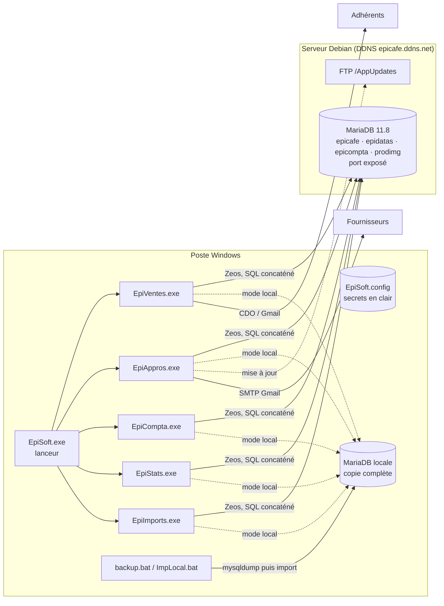
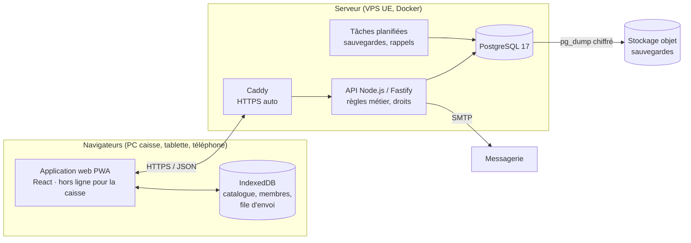
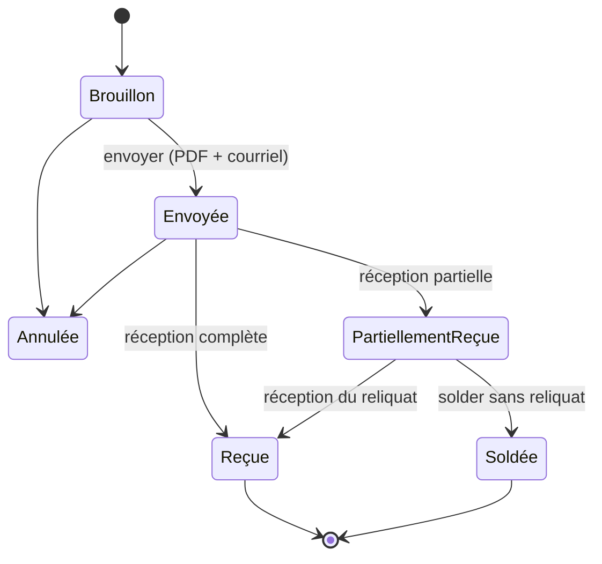
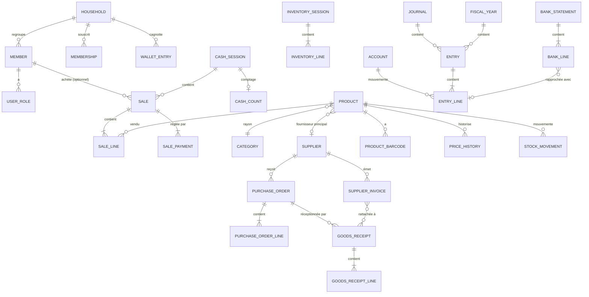

# EpiSoft Web — Spécifications de refonte

> **Objet :** décrire l'existant (EpiSoft, suite Free Pascal/Lazarus en production) et spécifier son remplacement par **une application web unifiée, responsive et utilisable hors ligne en caisse**.
>
> **Destinataires :** bureau de l'association Epicafé de Montjavoult ; développeurs, humains ou assistés par IA, chargés de la réalisation.
>
> **Version :** 1.0 — 2026-10-03
>
> **Règle :** l'application actuelle (`C:\Datas\Dev\Episoft`) reste en production et **n'est pas modifiée**. La v2 est développée dans ce dossier (`C:\Datas\Dev\EpiSoft-Web`) et ne lit l'ancienne base qu'en lecture, pour la migration.
>
> **Sources :**
> - analyse complète du code source : `EpiVentes`, `EpiAppros`, `EpiCompta`, `EpiStats`, `EpiImports`, `Shared`, lanceur, `AppUpdater` ;
> - schéma réel de la base MariaDB 11.8, lu dans `information_schema` ;
> - dumps `Datas\Backup\Databases\*.sql` et procédures stockées ;
> - règles d'import bancaire `Datas\Models.txt` et requêtes `Datas\Requêtes\*.sql` ;
> - documentation existante (`Documentation\`, `Todo.txt`).

---

## Sommaire

1. [Objet, périmètre et glossaire](#1-objet-périmètre-et-glossaire)
2. [État des lieux](#2-état-des-lieux)
3. [Vision cible et principes directeurs](#3-vision-cible-et-principes-directeurs)
4. [Exigences fonctionnelles par domaine](#4-exigences-fonctionnelles-par-domaine)
5. [Exigences non fonctionnelles](#5-exigences-non-fonctionnelles)
6. [Modèle de données cible](#6-modèle-de-données-cible)
7. [Architecture technique et pile recommandée](#7-architecture-technique-et-pile-recommandée)
8. [API et synchronisation hors ligne](#8-api-et-synchronisation-hors-ligne)
9. [Migration des données](#9-migration-des-données)
10. [Feuille de route par lots](#10-feuille-de-route-par-lots)
11. [Risques, hypothèses et questions ouvertes](#11-risques-hypothèses-et-questions-ouvertes)
12. [Annexes](#12-annexes)

---

## 1. Objet, périmètre et glossaire

### 1.1 Objet

EpiSoft gère l'épicerie associative : caisse, adhérents et leur cagnotte, catalogue produits, fournisseurs, commandes, stock, inventaire, comptabilité, statistiques et imports. Il se compose aujourd'hui de cinq exécutables Windows distincts. Ils partagent une base MariaDB exposée sur Internet et un fichier de configuration qui contient des secrets en clair.

La refonte vise à :

- **unifier** les modules dans une seule application web, avec une seule connexion et des droits par rôle ;
- la rendre **utilisable sur tout appareil** : PC de caisse, tablette, téléphone ;
- garantir que **la caisse fonctionne sans Internet** et se synchronise ensuite ;
- **fiabiliser les données** : transactions, contraintes, montants exacts, journal des mouvements ;
- **corriger** les anomalies relevées (§2.6) ;
- **automatiser** ce qui est aujourd'hui manuel, en particulier les écritures comptables des ventes, des cotisations et des factures ;
- **sécuriser** l'ensemble : mots de passe hachés, HTTPS, aucun secret dans le code, base non exposée.

### 1.2 Périmètre

| Inclus | Exclu (hors v1) |
|---|---|
| Tous les modules actuels : Caisse, Membres/Foyers/Cagnotte, Appros (fournisseurs, produits, commandes, factures, inventaire), Comptabilité, Statistiques, Imports | Boutique en ligne grand public (Epicerio reste en place, voir §4.13) |
| Reprise de toutes les données existantes | Paie, gestion des bénévoles et des plannings |
| Exports Excel, CSV et PDF | Liasse fiscale automatique (2035…) |
| Remplacement du lanceur, de la mise à jour par FTP et des scripts `.bat` | Application mobile native (la PWA suffit) |

### 1.3 Glossaire

| Terme | Définition |
|---|---|
| **Membre** | Personne physique enregistrée (`epicafe.membres`) : bénévole, caissier, adhérent. |
| **Foyer / Adhérent** | Unité qui porte l'adhésion et la cagnotte (`epicafe.adherents`). Par convention, l'identifiant du foyer est celui du membre « référent ». Chaque membre est rattaché à un foyer par `MBREREF`. |
| **Adhésion** | Droit d'acheter, pour une durée en mois (`ADHDUREE`, 12 par défaut). L'adhésion annuelle est le produit `01002` (12 €). L'adhésion « de passage » est le produit `01001` (2 €). |
| **Cagnotte** | Porte-monnaie prépayé d'un foyer (`ADHSOLDE`). Elle est alimentée par des versements (motif `01010`) et débitée par les achats (motif `01011`). |
| **Ticket** | Une vente en caisse : un en-tête (`tickets`) et des lignes (`ticketdetails`). |
| **Ticket en attente** | Ticket mis de côté en mémoire pendant qu'on sert un autre client (bouton « + »). |
| **Tables tmp** | `tmptickets`, `tmpticketdetails` et `tmpadhpayements` : les saisies de la journée, recopiées dans les tables définitives à la clôture. |
| **Clôture de session** | Fin de journée : copie des tickets tmp vers les tables définitives, décrément du stock, débit des cagnottes. |
| **Fond de caisse (FDC)** | Espèces laissées en caisse pour la session suivante (`epicafe.params`, `FOND_CAISSE`). |
| **Contrôle de caisse** | Comptage des billets et pièces, comparé aux espèces théoriques. |
| **Motif de paiement** | Code produit à 5 caractères porté par un paiement : `01001` adhésion de passage, `01002` adhésion annuelle, `01003` valeur par défaut non documentée, `01004` don ou autre, `01010` versement sur la cagnotte, `01011` débit de la cagnotte (libellé trompeur « Ventes sur place »). |
| **PAYMOD** | Mode de paiement : 0 espèces, 1 chèque, 2 carte, 3 virement. La valeur 3 est aussi utilisée, à tort, pour les débits de cagnotte. |
| **TICKMODPAY** | Chaîne `esp|chq|cb|cag` qui porte les montants par mode de paiement d'un ticket. |
| **Univers / Rayon** | Classement produit à deux niveaux, par exemple univers 4 « Liquides », rayon 01 « Eaux ». |
| **Code produit** | 6 chiffres : univers (1) + rayon (2) + séquence (3), par exemple `604006`. Les codes `0xxxxx` désignent des services : adhésions, cagnotte. |
| **Code fournisseur** | 4 chiffres : région (2) + séquence (2), par exemple `0701`. `0001` désigne le fournisseur divers. |
| **PRODPACHG** | Indicateur « prix changé, étiquette à imprimer ». |
| **Commande fournisseur** | Statuts : 0 en attente, 1 envoyée, 2 reçue, 3 traitée (stock et prix mis à jour). |
| **Facture fournisseur** | Statuts : 0 à régler, 1 réglée, 2 comptabilisée. `FACTCPTA` indique qu'elle est passée en comptabilité. |
| **Mouvement / Écriture** | En comptabilité, un *mouvement* (`mouvements`) est l'en-tête d'une pièce et ses *écritures* (`ecritures`) en sont les lignes débit/crédit. |
| **Journal** | ACH achats, BNQ banque, CAI caisse, VTE ventes, OD opérations diverses, RAN reports à nouveau. |
| **Guide** | Modèle de saisie comptable : catégorie, journal, lignes pré-remplies. |
| **Rapprochement** | Pointage des écritures du compte 512 avec le relevé bancaire. |
| **RAN** | Report à nouveau : reprise des soldes de bilan en début d'exercice. |
| **Epicerio** | Boutique en ligne et back-office BTCQ (`epiceriemontjavoult.btcq.fr`), source des exports CSV importés. |
| **Exercice** | Année civile (`CurrentExercice` dans la configuration). |

---

## 2. État des lieux

### 2.1 Architecture actuelle



**Constats structurants :**

- **Un exécutable par module.** Chaque module hérite de `TBaseForm` (`Shared\Forms\ubasefrm.pas`). Au démarrage, ce formulaire :
  1. lit `..\EpiSoft.config` ;
  2. propose de resynchroniser la base locale ;
  3. ouvre la connexion ;
  4. affiche la fenêtre de connexion ;
  5. crée un conteneur d'onglets.

  Chaque écran est une *frame* (`TBaseFrame`).
- **Accès aux données par un pseudo « Active Record ».** La classe `TTable` (bibliothèque externe `C:\Applis\Lazarus\Utils\uMySqlTools.pas`) fournit `Execute`, `GetStringData`, `ExportToStrings`… Chaque table a sa classe Pascal (`TPRODUITS`, `TADHERENT`, `TTICKETS`, `TMOUVEMENTS`…).
  - Tout le SQL est construit par **concaténation de chaînes**, sans paramètres ni transactions.
  - Les lignes de résultat circulent sous forme de **chaînes séparées par des virgules, sans échappement**.
- **État global :** `sPreferences`, `sConnection`, `sProdList` (cache produits), `sMbreList` (cache membres avec leurs soldes).
- **Mode hors ligne :**
  - `UseLocal=oui` bascule la connexion sur une MariaDB locale.
  - Chaque écriture sur la base distante positionne `NeedImport`. Au démarrage suivant en mode local, `backup.bat` puis `ImpLocal.bat` **remplacent intégralement** la base locale.
  - Les ventes locales sont poussées à la clôture vers les tables tmp distantes, sans détection de conflit.
- **Dépendances hors dépôt :** paquet de composants personnel `bruno` et utilitaires `C:\Applis\Lazarus\…`, référencés par chemins absolus ; ZeosLib, Synapse, LazReport, Fortes, lazbarcodes.
- **Mise à jour applicative :** FTP en clair vers `epicafe.ddns.net/AppUpdates`, identifiants dans le code, versions comparées comme des chaînes. Elle est désactivée (`cDoUpdate = false`).
- **Pas de gestion de versions** (aucun dépôt git). Copies de sauvegarde et fichiers `_*.pas` mêlés au code.

### 2.2 Modules et écrans existants

#### 2.2.1 EpiVentes — Caisse et membres (code module `VTE`)

| Écran | Fonction |
|---|---|
| **Caisse** (`usaisieframe`) | Choix de l'adhérent (n°, recherche, QR), du caissier et de la date. Saisie des produits par scan EAN, code, recherche texte ou boutons-images. Grille du ticket, P.U. et quantité modifiables. Tickets en attente. Historique d'achats du membre : modifier un ticket, changer l'acheteur, envoyer l'historique ou le ticket par courriel. |
| **Quantité** (`usetqteprodfrm`) | Poids ou volume, 3 décimales, pour les produits non unitaires. |
| **Règlement** (`uvalidateticketfrm`) | Solde de la cagnotte, total, montant reçu, reste à payer, monnaie à rendre. Modes espèces, chèque, carte et débit de la cagnotte (ce dernier absent pour l'adhérent de passage). Plusieurs modes possibles sur un même ticket. |
| **Tableau de bord** (`utabbordfrm`) | Tickets du jour, clôturés ou en attente, avec totaux par mode. Modifier ou supprimer un ticket. Sauvegarder ou restaurer la base. **Clôture de session**, **contrôle de caisse**. |
| **Contrôle de caisse** (`uverifcaissefrm`) | Comptage de 12 billets et pièces, fond de caisse, adhésions et cagnottes encaissées, écart, prélèvement, nouveau fond. |
| **Membres** (`uadhmgrframen`) | Identité, contact, commune via le code postal, rôles, statut (Nouveau/Actif/Inactif/Archivé), QR code. Foyer : date, durée, fin, solde, notes. Saisie d'un règlement, historique des paiements. |
| **Règlement adhérent** (`uadhpaymentfrm`) | Versement avec mode et motif ; met à jour le solde ; reçu par courriel. |
| **Historique des paiements** (`ushowadhpayfrm`) | Liste filtrable ; modifier, supprimer, exporter en HTML, envoyer par courriel. |
| **Raccourcis produits** (`uimagesdlgfrm`) | Activation des boutons-images de la caisse. |
| **Prix modifiés** (`uchangedpricesfrm`) | Liste des étiquettes à refaire, remise à zéro. |
| **Contrôle des soldes** (`uvtecontrols`) | Compare `ADHSOLDE` à la somme des paiements (vue `CtrlAdhSolde`). |

#### 2.2.2 EpiAppros — Approvisionnements (code module `APP`)

| Écran | Fonction |
|---|---|
| **Produits** (`uprodmgrframe`) | Fiche complète (§2.4.2), navigation par fournisseur, recherche, historique des mouvements de stock, image et onglet de caisse. |
| **Recherche produit** (`ufsearchprodfrm`) | Par code, nom, fournisseur, univers, rayon. Activer ou désactiver ; demander ou annuler une étiquette. |
| **Fournisseurs** (`ufnrmanagerframe`) | Fiche fournisseur, compte 401, référent, lien vers les tarifs, factures, mise à jour des prix. |
| **Commandes** (`ucommandsmanagerframe`) | Grille des produits actifs du fournisseur ; quantités et prix d'achat modifiables ; totaux HT, TVA et TTC. Enregistrement, bon de commande PDF, envoi par courriel, finalisation à la réception. |
| **Liste des commandes** (`ushowfnrcmdlistfrm`) | Filtre par statut ; supprimer, changer le statut, ouvrir. |
| **Factures** (`ufacturesmgrfrm`, `ushowfnrfctlistfrm`) | Pièce, date, échéance, HT/TVA/TTC, statut, mode, lien vers le document. Liste filtrée ; marquage réglée / à régler. |
| **Prix en masse** (`upricesmgrfrm`) | Prix d'achat, marge et prix de vente de tous les produits d'un fournisseur. |
| **Inventaire** (`uinventaireframe`) | Quantités comptées, écart en quantité et en valeur, ajustement du stock. |
| **Import produits** (`uimportproductsframe`) | CSV produits Epicerio : création et mise à jour. |
| Liens externes | Boutique Epicerio, tableur Google des réservations, dossier Google Drive, client de messagerie. |

#### 2.2.3 EpiCompta — Comptabilité

| Écran | Fonction |
|---|---|
| **Saisie** (`usaisieframe`) | Journal, date, pièce, libellé, mode de règlement, grille débit/crédit, plan comptable en surimpression, arbre des guides, bouton « solder ». L'enregistrement n'est possible que si la saisie est équilibrée. |
| **Mouvements** (`umvtsframe`) | Pièces de l'exercice et leurs lignes ; recherche ; modifier, supprimer (refusé si la pièce est rapprochée), dupliquer. |
| **Rapprochement** (`urappbanqframe`) | Compte 512 et plage de mois ; pointage par double-clic, la référence étant le numéro du mois ; totaux rapprochés et non rapprochés. |
| **Éditions** (`ueditionsframe`) | Balance et Résultats (comptes 6 et 7) ; PDF via LazReport ; export CSV. |
| **Import** (`uimportecrframe`) | Relevé bancaire **OFX** (règles de `Datas\Models.txt`) et **factures fournisseurs** non comptabilisées, validées ligne par ligne. |
| **Guides** (`ugestguidesfrm`) | Consultation des modèles ; l'enregistrement n'est pas implémenté. |
| **Comptes** (`ucomptesmgrfrm`) | Création d'un compte, utilisée depuis la fiche fournisseur pour les 401. |
| Menus | Génération des RAN ; contrôles d'équilibre, de banque et de caisse ; choix de l'exercice (2025/2026 codés en dur). |

#### 2.2.4 EpiStats — Statistiques

- **Mouvements :** à partir d'un **CSV de mouvements de stock Epicerio**, entrées ou sorties par période et par fournisseur, avec coût, valeur, marge brute et taux de marge. Regroupement par produit, export CSV ou HTML, enregistrement dans `ventes` et `vtesdetail`.
- **Ventes :** à partir d'un **CSV de ventes Epicerio**, totaux par mode de paiement.
- **Requêtes :** éditeur SQL libre et bibliothèque de requêtes (`Datas\Requêtes\…`).
- Aucun graphique.

#### 2.2.5 EpiImports, DbImport, lanceur, AppUpdater

- **EpiImports :** import de produits (même écran que dans EpiAppros), de membres (CSV Epicerio) et d'écritures comptables (inachevé).
- **DbImport :** coquille vide.
- **Lanceur `EpiSoft.exe` :** barre d'icônes qui lance ou réactive chaque module, et bascule entre base locale et distante.
- **AppUpdater :** remplace l'exécutable téléchargé, puis relance le module.

### 2.3 Base de données actuelle (synthèse)

MariaDB 11.8. Quatre schémas sont utilisés. Le détail des colonnes figure en [annexe A](#a-schéma-actuel-complet).

| Schéma | Rôle | Tables principales |
|---|---|---|
| `epicafe` | Référentiel | `membres`, `adherents`, `produits`, `prodatas`, `fournisseurs`, `univers`, `rayons`, `regions`, `communes`, `params`, `produits_old` (obsolète) |
| `epidatas` | Transactions | `tickets`, `ticketdetails`, `tmptickets`, `tmpticketdetails`, `adhpayements`, `tmpadhpayements`, `fnrcommands`, `fnrcomdetail`, `facturesfnr`, `inventaire`, `logins`, `ventes`, `vtesdetail`, `remcheques`, `banques` |
| `epicompta` | Comptabilité | `comptes`, `journaux`, `mouvements`, `ecritures`, `ecritures1` (ancien format), `guides`, `guidetail`, `guidcat` |
| `prodimg` | Images de caisse | `prodimages` (blob), `imgtabs` |

**Caractéristiques problématiques :**

- **Aucune clé étrangère et aucun déclencheur.** Les relations ne sont qu'implicites (`PRODNUM = PRODATNUM`, `TICKADH = MBREID`, `ECRNUM = MVTNUM`…).
- **Identifiants de membres trop petits.** Les colonnes `MBREID`, `ADHID`, `LOGADH`, `RCMBRE` et `COMMUNEID` sont en `tinyint` : **127 valeurs au maximum**. Il y a déjà 120 membres.
- **Montants en `float`/`double`**, par exemple `ECRDEBIT float` ou `FNRCOMTOTHT float(6,2)`. Cela produit des erreurs d'arrondi, comme `501.049987792969` dans `comptes`.
- **Clés textuelles en `tinytext`/`text`** (`PRODNUM`, `FNRCODE`, `RAYID`…).
- **Données multi-valeurs dans une seule colonne :** `TICKMODPAY` (`esp|chq|cb|cag`), `MBREPERMS` (`0|1|3`), `PRODQUALITE` (`0,1`).
- **Mots de passe en clair :** le « mot de passe » de connexion est la chaîne du QR code (`MBREQRCODE`).
- **Vues :**
  - `ticketsview` et `tmpticketsview` découpent `TICKMODPAY` avec la fonction `split()` ;
  - `CtrlAdhSolde` sert au contrôle des soldes ;
  - `ecrbanques` contient les lignes 512 avec leur pointage ;
  - `balance des comptes` est la balance, tous exercices confondus.
- **Procédure** `updatefromcommande(code, paht, stock, date, qty, pv)`, appelée à la réception des commandes. La version présente dans le dépôt cible des colonnes qui ont depuis été déplacées vers `prodatas`.

**Volumétrie (03/10/2026) :** 120 membres, 110 foyers, 395 produits, 23 fournisseurs, 875 tickets et 3 591 lignes, 996 paiements, 178 commandes et 1 091 lignes, 137 factures, 461 mouvements comptables et 1 043 écritures.

### 2.4 Processus et règles de gestion extraits du code

#### 2.4.1 Vente en caisse

```mermaid
sequenceDiagram
  actor C as Caissier
  participant UI as Caisse
  participant T as tmptickets / tmpticketdetails
  participant D as tickets / ticketdetails
  participant P as prodatas / adherents / adhpayements
  C->>UI: choisit l'adhérent (obligatoire) + caissier (perm. 0)
  C->>UI: scan / recherche / bouton image → ligne (qté 1 ou poids)
  C->>UI: Valider → règlement multi-modes
  UI->>UI: courriel du ticket (optionnel, AVANT l'enregistrement)
  UI->>T: INSERT en-tête (TICKNUM = MAX+1) + REPLACE lignes
  UI->>UI: débit de la cagnotte EN MÉMOIRE seulement
  Note over UI,T: … fin de journée …
  C->>UI: Clôturer la session
  UI->>D: copie en-têtes (nouveau n°) + lignes
  UI->>P: stock -= qté (lecture puis écriture, non atomique)
  UI->>P: adhpayements : 1 débit 01011 par foyer ; ADHSOLDE recalculé
  UI->>T: vidage des tables tmp (sauf tmpadhpayements)
```

**Règles :**

- **Adhérent obligatoire.** Seuls sont proposés les membres de statut 1 (Actif) rattachés à un foyer. Le membre 0 « Adhérent de passage » sert aux clients sans adhésion.
- **Validation sans adhérent.** Le logiciel propose d'ajouter la ligne `01001`, adhésion de passage à **2 €**, valeur codée en dur.
- **Caissiers :** membres dont `MBREPERMS` commence par `0`.
- **Quantité :** un produit unitaire (`PRODTYPVTE=0`) ajoute 1 à chaque scan. Pour un produit au poids ou au volume, le caissier saisit la quantité (3 décimales). Un même produit scanné deux fois cumule sa quantité sur la même ligne.
- **Prix :** `PRODPRIXVTE` est un prix TTC. Le prix unitaire et la quantité restent modifiables à la main. Il n'existe **ni remise ni promotion**.
- **Calculs :** ligne = P.U. × quantité, arrondie à 2 décimales à l'affichage. Total = somme des lignes affichées.
- **Règlement :** le ticket est soldé quand `arrondi(Σ règlements × 100) ≥ arrondi(total × 100)`. Monnaie rendue = dernier montant saisi − total. Le paiement par cagnotte est refusé pour le membre 0 ; un solde insuffisant ne déclenche qu'un **avertissement**.
- **`TICKHASEXTRA`** est vrai si une ligne a un code < `100000`, c'est-à-dire un service.
- **Échec d'enregistrement :** le ticket est sauvé dans `Datas\TempVentes\TmpTick.txt` et rechargé au démarrage suivant.
- **Stock :** il **n'est décrémenté qu'à la clôture**, y compris pour les services. Exemple : le produit `01001` a un stock de −2.
- **Pas d'impression de ticket.** Le seul justificatif est le courriel HTML.

#### 2.4.2 Produits et prix

- **Deux tables pour un produit :**
  - `produits` contient la description : nom, type de vente, quantité unitaire, unité, EAN, condition de vente, fournisseur, référence fournisseur, univers, rayon, qualités, taux de TVA, statut ;
  - `prodatas` contient l'économie et le stock : PA HT, PA TTC, PV TTC, stock, stock minimum, dernière commande, dernière quantité, quantité inventoriée, `PRODPACHG`.
- **Codification :**

  | Champ | Valeurs |
  |---|---|
  | `PRODTYPVTE` | 0 unité, 1 poids, 2 volume |
  | `PRODUNITVTE` | 0 g, 1 kg, 2 ml, 3 L |
  | `PRODCONDVTE` | 0 sur place, 1 sur commande, 2 les deux |
  | `PRODQUALITE` | 0 local, 1 bio, 2 saisonnier, 3 courant (plusieurs valeurs possibles) |
  | `PRODSTATUT` | 0 en commande, 1 actif, 2 inactif, 3 indisponible |
  | Taux de TVA | 5,5 %, 10 %, 20 % |

- **Formules :**
  - `PA_TTC = PA_HT × (1 + TVA/100)` et `PA_HT = PA_TTC / (1 + TVA/100)` ;
  - prix au kg/L : `PV × 1000 / qté` pour une unité en g ou ml, `PV / qté` pour une unité en kg ou L ;
  - **la marge a trois définitions incohérentes selon l'écran :**

    | Écran | Formule |
    |---|---|
    | Formulaire de prix | `(PV − PA_TTC) / PA_TTC × 100` (taux de marque sur coût TTC) |
    | Chargement de la fiche produit | `(PV − PA_HT) / PV × 100` |
    | Éditeur de prix | `PV = PA_TTC × marge`, sans le `1 +` ni la division par 100 |

- **Contrôles à l'enregistrement d'une fiche :** nom, type, univers, rayon, code cohérent avec univers + rayon, quantité, condition, unité, au moins une qualité, fournisseur, PA HT, TVA, PA TTC, PV et statut sont obligatoires.
- **Étiquettes (`PRODPACHG` = 1) :** l'indicateur est posé à la création d'un produit, lors d'une modification de prix ou d'une demande d'étiquette, et à la réception d'une commande dont le prix de vente diffère. La liste est affichée au démarrage de la caisse, puis remise à 0 à la main.

#### 2.4.3 Commandes fournisseurs et réception

1. **Préparation :** la grille affiche tous les produits actifs du fournisseur. On y saisit les quantités et on ajuste les prix d'achat. Totaux : `HT = Σ PA_HT × q`, `TVA = Σ PA_HT × q × taux`, `TTC = HT + TVA`.
2. **Enregistrement :** statut 0. Le numéro de commande est obtenu par `MAX(FNRCOMID)`.
3. **Bon de commande :** si `FNRBONCMD = 1`, un PDF LazReport est produit dans `Datas\Commandes\<Fournisseur>_Cmd_<date>.pdf`. Il peut être envoyé par courriel depuis l'adresse pro ; la commande passe alors au statut **1**.
4. **Réception :** le statut passe à **2** manuellement.
5. **Finalisation :** pour chaque ligne, le logiciel appelle `updatefromcommande`, qui fixe `stock = stock affiché + quantité` (valeur absolue) et met à jour les prix et la date de dernière commande. La commande passe au statut **3**.
   - Les quantités modifiées à la réception servent au calcul du stock mais ne sont pas réenregistrées dans la commande.
   - Les livraisons partielles et les reliquats ne sont pas gérés.
6. **Factures :** elles sont liées au fournisseur seulement, sans lien avec la commande. L'enregistrement exige que la date d'échéance soit postérieure ou égale à la date de facture et que HT, TVA et TTC soient non nuls.

#### 2.4.4 Stock et inventaire

- **Le stock n'est porté que par `prodatas.PRODSTOCK`.** Aucun journal des mouvements n'est tenu ; l'historique est reconstitué à la volée à partir de `inventaire`, des commandes et des tickets.
- **Le stock est écrit à sept endroits :**
  1. la clôture des ventes (−) ;
  2. la réception d'une commande (valeur absolue) ;
  3. l'ajustement d'inventaire ;
  4. la saisie directe du « stock théorique » ;
  5. l'enregistrement d'une fiche produit (valeur possiblement périmée) ;
  6. la création par import ;
  7. la mise à jour par import (écrasement).
- **Inventaire :** les quantités saisies sont écrites dans `PRODINV` **pour toutes les lignes, vides comprises (0)**. Le logiciel propose ensuite de recopier `PRODINV` dans `PRODSTOCK`. La table `inventaire` n'est jamais écrite par l'application.

#### 2.4.5 Adhésions et cagnotte

- **Fin d'adhésion :** `ADHDATE + ADHDUREE mois − 1 jour`. Il n'y a ni contrôle d'expiration en caisse ni relance.
- **Versement (motif 01010) :** insertion dans `adhpayements` et `ADHSOLDE += montant` immédiatement ; reçu par courriel.
- **Achat payé par cagnotte :** débit **en mémoire** pendant la journée. À la clôture, pour chaque foyer, une ligne `01011` est créée avec le montant `−Σ CAG` du jour, puis `ADHSOLDE` est **recalculé** à partir de tous les paiements de motif `0101%`.
- **Invariant visé :** `ADHSOLDE = Σ adhpayements.PAYMNT WHERE PAYMOTIF LIKE '0101%'`.
- **Référence de virement `ADHREFVIR` :** elle existe en base mais n'est ni saisissable ni exploitée.
- **QR code :** chaîne aléatoire de 15 caractères. Elle sert à l'identification en caisse **et** de mot de passe.

#### 2.4.6 Clôture et contrôle de caisse

- **Espèces théoriques :** somme des parts « espèces » de `TICKMODPAY` pour la journée.
- **Formules :**
  - (2) espèces comptées = Σ (nombre × valeur faciale), pour 50 €, 20 €, 10 €, 5 €, 2 €, 1 €, 0,50 €, 0,20 €, 0,10 €, 0,05 €, 0,02 € et 0,01 € ;
  - (3) recette = (2) − fond de caisse (1) ;
  - (6) ventes nettes en espèces = (3) − adhésions (4) − versements cagnotte (5) ;
  - écart = (6) − espèces théoriques (7) ;
  - nouveau fond de caisse = (2) − prélèvement (8).
- **Résultat :**
  - un fichier `Datas\TempVentes\AAAA-MM-JJ_FDC.txt` ;
  - la mise à jour de `params.FOND_CAISSE`.

#### 2.4.7 Comptabilité

- **Plan comptable :** plan associatif à 6 chiffres. Comptes clés :

  | Compte | Usage |
  |---|---|
  | 401xxx | Un compte par fournisseur |
  | 411000 | Cagnottes des adhérents |
  | 511200 | Chèques à encaisser |
  | 511300 | Cartes à encaisser |
  | 512001 | Crédit Agricole |
  | 531000 | Caisse |
  | 607000 | Achats de marchandises |
  | 707000 | Ventes |
  | 754000 | Dons |
  | 756000 | Cotisations |
  | 890000 | Report à nouveau |

- **Saisie :** un en-tête `mouvements` (journal, date, pièce, libellé, mode) et ses lignes `ecritures` (compte, libellé, débit, crédit).
  - L'équilibre n'est contrôlé que dans l'écran de saisie, par comparaison exacte de flottants.
  - La date doit appartenir à l'exercice.
  - Le compte n'est pas contrôlé.
- **Rien n'est automatique :**
  - les ventes sont passées à la main avec le guide « Ventes Semaine xx » : 531/511200/511300/411000 au débit, 707000 au crédit ;
  - les cotisations ne sont pas passées en comptabilité.
- **Factures fournisseurs (semi-automatique) :** pour chaque facture non comptabilisée, le logiciel propose une écriture ACH « 607000 au débit du TTC, 401xxx au crédit ». La validation est manuelle, puis `FACTCPTA = 1`.
- **Import OFX :** chaque transaction est rapprochée de la **première** règle de `Models.txt` dont le texte figure dans le libellé, au format `CompteDébit,CompteCrédit,Mode,PosLibellé=Texte`. Le montant est pris en valeur absolue et le sens vient de la règle.
  - Il n'y a **pas de dédoublonnage** : l'identifiant de transaction `FITID` est ignoré.
- **Rapprochement :** `MVTRAPP` reçoit le **numéro du mois** du relevé. Ce pointage se fait par pièce, pas par ligne. Il n'y a ni solde de relevé ni écart calculé.
- **Éditions :**
  - balance par période ;
  - résultats (comptes 600000 à 799999), avec une ligne « 120000 Excédent » ou « 129000 Déficit » ;
  - PDF et CSV.

  Il n'existe **pas** de grand livre ni d'édition du journal qui fonctionnent.
- **RAN :** les comptes de bilan (< 600000) de l'exercice N−1 sont soldés et repris avec une contrepartie au 890000, dans le journal RAN. Il n'y a **ni clôture, ni verrouillage, ni affectation du résultat**, et le drapeau `MVTVALIDE` n'est jamais positionné.

### 2.5 Droits actuels

Les droits sont stockés dans `membres.MBREPERMS`, sous forme d'indices séparés par `|`.

| Indice | Rôle | Contrôlé aujourd'hui ? |
|---|---|---|
| 0 | Tenue de caisse | Oui : bouton Caisse, liste des caissiers |
| 1 | Commandes en ligne | Non |
| 2 | Commandes gestion | Non |
| 3 | Adhérents gestion | Oui : bouton Membres |
| 4 | Produits gestion | Non |
| 5 | Commandes fournisseurs | Non |
| 6 | Compta gestion | **Non** : tout membre ayant un identifiant peut ouvrir la comptabilité |

**Connexion :** `SELECT … FROM membres WHERE MBREUSERNAME = "<saisie>"` (injectable), puis comparaison en clair avec `MBREQRCODE`. Le journal `logins` n'est alimenté que par EpiAppros.

### 2.6 Anomalies relevées

Les anomalies sont classées par gravité. Chacune est **traitée par une exigence de la v2**, indiquée en dernière colonne.

#### 2.6.1 Critiques : perte ou corruption de données

| # | Anomalie | Exigence v2 |
|---|---|---|
| C1 | **La clôture est cassée depuis la dernière modification.** La requête `WHERE TICKDATE=dt` contient le nom de variable au lieu de sa valeur. | §4.5 |
| C2 | **La cagnotte est débitée sur la mauvaise clé.** Le ticket porte l'identifiant du membre, mais la clôture le joint à celui du foyer : les achats des autres membres du foyer ne sont jamais débités. | §4.3, R-CAG-02 |
| C3 | **Le tableau de bord redébite la cagnotte en mémoire** à chaque ouverture. Modifier un ticket clôturé écrit dans les tables tmp et redébite sans annuler le débit initial. | §4.4, R-VTE-12 |
| C4 | **La recherche par QR en caisse est inopérante** : les champs sont décalés. | §4.1 |
| C5 | **La recherche produit est approximative :** une sous-chaîne du code peut sélectionner un autre produit, via son EAN, son nom ou son prix. | §4.4, R-VTE-03 |
| C6 | **La clôture est fragile :** pas de transaction, numéros calculés par `MAX+1`, paiements tmp recopiés à chaque clôture (jamais vidés), double débit si l'on clôture deux fois, stock local et tickets distants désynchronisés. | §4.5, §8 |
| C7 | **Activer ou désactiver un produit n'est jamais enregistré** : la colonne visée n'existe pas dans la table. | §4.6 |
| C8 | **Enregistrer une fiche produit écrase deux champs** (dernière quantité commandée et quantité inventoriée, par le stock minimum) et réécrit un stock possiblement périmé. | §4.9 |
| C9 | **L'inventaire écrit 0 pour les produits non comptés**, puis met leur stock à 0. La saisie du stock théorique est enregistrée immédiatement, sans confirmation. | §4.9 |
| C10 | **La réception d'une commande calcule le stock depuis une valeur affichée périmée**, inclut les lignes supprimées et efface les demandes d'étiquette en attente. | §4.8 |
| C11 | **Aucune transaction** : un échec en cours de mise à jour d'une pièce comptable supprime la pièce d'origine. | §5.2 |
| C12 | **Montants en `float`**, contrôles d'équilibre par égalité exacte. | §6 |
| C13 | **Identifiants en `tinyint`** : 127 membres au maximum, alors qu'il y en a 120. | §6 |
| C14 | **Les lignes de résultat circulent en CSV sans échappement :** une virgule dans un nom ou un commentaire décale les champs, prix compris. | §7 (ORM typé) |
| C15 | **L'import OFX n'est pas dédoublonné** (identifiant ignoré). La règle « REMISE DE CHEQUE » vise le compte 511300 (cartes) au lieu de 511200. | §4.11 |
| C16 | **Les RAN sont datés du 01/01 de l'année précédente** et peuvent être générés deux fois. Le contrôle d'équilibre boucle à l'infini ; le contrôle de caisse plante. | §4.11 |
| C17 | **La mise à jour des membres par import ajoute le solde du fichier au solde existant** au lieu de le remplacer. | §4.13 |
| C18 | **La procédure `updatefromcommande`, appelée pour finaliser une commande, n'existe pas dans la base de production.** Au 03/10/2026, `information_schema.ROUTINES` ne contient que `split` et `_split`. La version du dépôt cible des colonnes déplacées. La finalisation des réceptions ne met donc vraisemblablement plus à jour le stock ni les prix. **À vérifier en priorité sur l'application en service.** | §4.8 |

#### 2.6.2 Fonctionnelles

- **Paiement en caisse :**
  - le reste à payer n'est pas recalculé après un paiement partiel ;
  - un double appui sur Entrée compte le règlement deux fois ;
  - le courriel est envoyé avant l'enregistrement du ticket.
- **Tickets en attente :** ils ne sont jamais retirés de la liste, ce qui provoque de fausses alertes de « tickets non soldés ».
- **Fiche membre :**
  - l'enregistrement efface les rôles 3 à 6 (seules les cases 0 à 2 sont rechargées) ;
  - il efface aussi `ADHREFVIR`, `ADHQRCODE` et `ADHSTATUT` ;
  - les boutons précédent/suivant ne fonctionnent pas ;
  - les membres de statut « Nouveau » sont invisibles en caisse.
- **Contrôle de caisse :** les versements par chèque ou virement sont déduits des espèces, et une écriture se fait hors des bornes d'un tableau.
- **Commandes fournisseurs :**
  - les commentaires ne sont jamais enregistrés (mauvaise colonne) ;
  - le bon de commande mélange HT et TTC ;
  - le menu de statut affiche les libellés des factures ;
  - un fournisseur sans commune bloque l'enregistrement de ses commandes ;
  - « Supprimer tout » efface toutes les commandes de tous les fournisseurs.
- **Factures fournisseurs :**
  - les modes de paiement ne sont pas alignés entre la saisie et la liste (espèces et prélèvement mal gérés) ;
  - une facture sans TVA ne peut pas être enregistrée.
- **Comptabilité :**
  - le test « saisie vide ? » est inversé, si bien qu'un guide écrase la saisie en cours et que « Enregistrer comme guide » échoue toujours ;
  - « Dupliquer » ne duplique rien ;
  - les guides ne peuvent pas être enregistrés ;
  - les éditions sont décalées d'une colonne ;
  - le PDF est toujours écrit au chemin par défaut ;
  - le recalcul des soldes s'arrête au premier compte inchangé ;
  - des comptes à 8 chiffres sont utilisés dans des guides alors qu'ils n'existent pas dans le plan ;
  - « Importer tout » ne fait rien.
- **Statistiques :**
  - le regroupement par produit calcule un PA erroné ;
  - le regroupement des ventes utilise les colonnes d'un autre fichier ;
  - deux totaux sont inversés dans l'enregistrement ;
  - la requête de démarrage lit une colonne qui a été déplacée.
- **Historique de stock :** date de départ codée en dur au 15/04/2026 ; les commandes non reçues y sont comptées comme entrées.
- **Codes à capacité limitée :** 99 fournisseurs au maximum par région ; numéro de compte 401 suivant calculé sur le maximum global.

#### 2.6.3 Sécurité

- **Secrets en clair :**
  - mot de passe de la base, clés d'application Gmail et mot de passe DbTools dans `EpiSoft.config` ;
  - identifiants FTP dans `updatermgr.pas` ;
  - identifiant distant dans `uVtesDataDefs.pas` ;
  - mots de passe root dans les `.bat` ;
  - clé privée `private key.ppk` à la racine du projet ;
  - notes d'administration contenant des mots de passe.
- **Injection SQL** possible partout (concaténation, aucune échappement).
- **Authentification faible :** mot de passe = QR code, comparé en clair, sans limitation des tentatives.
- **Contrôle d'accès quasi absent :** rien n'est contrôlé en comptabilité ni pour les produits.
- **Exposition réseau :** base MariaDB ouverte sur Internet via le DDNS, sans TLS ; mises à jour par FTP en clair, sans contrôle d'intégrité.

---

## 3. Vision cible et principes directeurs



**Principes :**

1. **Une seule application, un seul compte.** Les menus affichés dépendent des rôles de l'utilisateur ; il n'y a plus de lanceur ni d'exécutable par module.
2. **Responsive d'abord.**
   - La caisse est optimisée pour un écran tactile de 10 à 15 pouces et une douchette code-barres.
   - Le back-office est utilisable sur téléphone : consulter un stock, saisir une réception, pointer un inventaire.
3. **Caisse hors ligne.**
   - La caisse peut vendre sans réseau pendant au moins une journée complète.
   - Les ventes sont identifiées par un UUID généré sur l'appareil, ce qui rend leur envoi **idempotent** : renvoyer deux fois la même vente ne crée pas de doublon.
4. **Le serveur est la seule source de vérité.** Toutes les règles métier sont appliquées côté API ; le client ne fait que proposer.
5. **Intégrité.**
   - Chaque opération métier s'exécute dans une transaction.
   - La base porte des clés étrangères et des contraintes `CHECK`.
   - Les montants sont stockés en `NUMERIC(12,2)` ; les quantités en `NUMERIC(12,3)`.
6. **Journaux plutôt qu'écrasements.**
   - Le **stock** est la somme des mouvements de stock.
   - La **cagnotte** est la somme des opérations du portefeuille du foyer.
   - La **comptabilité** est la somme des écritures validées.

   Les soldes affichés sont calculés à partir de ces journaux (ou tenus dans un cache recalculable), jamais saisis à la main.
7. **Comptabilité alimentée automatiquement.** Les ventes, les versements et adhésions, les factures fournisseurs et les relevés bancaires produisent des écritures en *brouillon*. Le trésorier les valide ; une écriture validée ne peut plus être modifiée et ne se corrige que par une contre-passation.
8. **Traçabilité.** Toute création, modification ou suppression est inscrite dans un journal d'audit : qui, quand, avant, après.
9. **Sécurité par défaut.**
   - Mots de passe hachés.
   - HTTPS obligatoire.
   - Secrets dans des variables d'environnement.
   - Requêtes paramétrées uniquement.
   - Base de données non exposée sur Internet.
10. **Paramétrable.** Les prix des adhésions, les taux de TVA, les comptes comptables, les modèles de courriel et les règles d'import bancaire sont modifiables dans l'application, sans toucher au code.

---

## 4. Exigences fonctionnelles par domaine

**Conventions :**

- Chaque règle porte un identifiant `R-<DOMAINE>-nn`, réutilisable dans les tests.
- « CA » signifie critère d'acceptation.
- Le statut de chaque règle est indiqué : **[reprise]** pour un comportement actuel conservé, **[corrigé]** pour une anomalie corrigée, **[nouveau]** pour une fonction nouvelle.

### 4.1 Authentification, utilisateurs et rôles

**Récits utilisateur :**

- En tant que bénévole, je me connecte avec mon identifiant et mon mot de passe, et je ne vois que les fonctions de mes rôles.
- En tant que caissier, je change d'utilisateur sur le poste de caisse en scannant mon badge QR, sans retaper de mot de passe tant que la session de caisse est ouverte.
- En tant qu'administrateur, j'attribue des rôles aux membres et je consulte le journal des connexions.

**Règles :**

- **R-AUTH-01 [corrigé]** Le mot de passe est distinct du QR code et stocké haché (Argon2id). Il doit comporter au moins 10 caractères.
- **R-AUTH-02 [nouveau]** Réinitialisation du mot de passe par lien envoyé par courriel, valable 1 heure. Le lien « Mot de passe oublié » n'était pas implémenté jusqu'ici.
- **R-AUTH-03 [nouveau]** Après 5 échecs de connexion, la connexion est bloquée 15 minutes pour cet identifiant.
- **R-AUTH-04 [supprimé]** Plus de changement de caissier par badge : le caissier est l'utilisateur connecté (R-VTE-01). Chacun se connecte avec son compte, même sur un poste partagé. Le badge QR sert uniquement à identifier un adhérent à la vente. Il ne donne jamais accès au back-office.
- **R-AUTH-05 [reprise + corrigé]** Rôles :

  | Rôle | Ancien indice | Accès |
  |---|---|---|
  | `CAISSE` | 0 | Caisse, tickets du jour, contrôle de caisse |
  | `COMMANDES_EN_LIGNE` | 1 | Précommandes clients (§4.14) |
  | `COMMANDES_GESTION` | 2 | Gestion des précommandes |
  | `ADHERENTS` | 3 | Membres, foyers, cagnottes, paiements |
  | `PRODUITS` | 4 | Catalogue, prix, étiquettes, images |
  | `APPROS` | 5 | Fournisseurs, commandes, réceptions, factures, inventaire |
  | `COMPTA` | 6 | Comptabilité, banque, éditions, clôture |
  | `STATS` | nouveau | Statistiques et exports |
  | `ADMIN` | nouveau | Utilisateurs, rôles, paramètres, audit, imports |

- **R-AUTH-06** Les droits sont vérifiés **côté serveur** sur chaque point d'accès de l'API. Le masquage des menus côté client n'est qu'un confort.
- **R-AUTH-07** Chaque connexion et déconnexion est journalisée avec l'utilisateur, la date, l'appareil et l'adresse IP. Le journal `logins` actuel est repris.
- **CA :** un membre sans rôle `COMPTA` reçoit une erreur 403 sur `/api/compta/*`. Un QR code scanné sur la page de connexion ne permet pas de se connecter.

### 4.2 Membres et foyers

**Récits utilisateur :**

- Je crée un membre, je le rattache à un foyer existant ou j'en fais le référent d'un nouveau foyer.
- Je vois d'un coup d'œil si l'adhésion du foyer est à jour, son solde de cagnotte et ses derniers achats.
- J'importe ou je mets à jour les membres depuis l'export Epicerio.

**Règles :**

- **R-MBR-01 [reprise]** Un **membre** a :
  - nom et prénom (obligatoires) ;
  - adresse, code postal, commune (choisie dans le référentiel par code postal) ;
  - téléphone, courriel ;
  - statut : Nouveau, Actif, Inactif ou Archivé ;
  - visible publiquement (oui/non), abonné à la lettre d'information (oui/non) ;
  - identifiant de connexion (proposé sous la forme `Prénom_NOM`) ;
  - QR code ;
  - rôles.
- **R-MBR-02 [corrigé]** Un **foyer** a un identifiant **propre** : il n'est plus confondu avec celui d'un membre. Il a un membre référent, des notes et une référence de virement, et regroupe 1 à n membres.
- **R-MBR-03 [corrigé]** Les membres « Nouveau » **et** « Actif » peuvent acheter. Les membres « Inactif » ou « Archivé » sont refusés en caisse, avec un message clair.
- **R-MBR-04 [nouveau]** La **référence de virement** du foyer (ex-`ADHREFVIR`) est saisissable. Elle sert à affecter automatiquement les virements reçus sur la cagnotte (§4.11).
- **R-MBR-05 [reprise]** Le QR code est une chaîne aléatoire d'au moins 15 caractères, générée à la création. Il est régénérable, imprimable sous forme de badge PDF et envoyable par courriel.
- **R-MBR-06 [nouveau]** Recherche de membres par nom, prénom, numéro, courriel, téléphone ou QR. Elle est tolérante aux accents et aux majuscules.
- **R-MBR-07 [nouveau]** Fiche « 360° » : foyer, adhésions, solde, opérations de cagnotte, tickets, paiements.
- **R-MBR-08 [nouveau]** RGPD :
  - export des données d'un membre ;
  - anonymisation à l'archivage (nom remplacé par « Membre #n », contact effacé), qui conserve les montants pour la comptabilité ;
  - le consentement à la lettre d'information est horodaté.
- **R-MBR-09 [corrigé]** Enregistrer une fiche ne modifie **que** les champs présents dans le formulaire. Les rôles et les autres données ne sont pas perdus.
- **R-MBR-10** Le membre spécial « Adhérent de passage » est remplacé par une **vente sans adhérent** (champ vide) : il n'y a plus de pseudo-membre 0.
- **CA :** créer 300 membres fonctionne (plus de limite à 127). Modifier le téléphone d'un membre caissier conserve son rôle `CAISSE`.

### 4.3 Adhésions et cagnotte

**Règles adhésion :**

- **R-ADH-01 [reprise + paramétrable]** Types d'adhésion paramétrables. Valeurs initiales :

  | Type | Prix | Durée |
  |---|---|---|
  | Annuelle | 12 € | 12 mois |
  | De passage | 2 € | le jour même |

- **R-ADH-02 [reprise]** Une adhésion a un foyer, un type, une date de début, une date de fin (`début + durée − 1 jour`), un montant et un paiement associé.
- **R-ADH-03 [nouveau]** En caisse, un foyer dont l'adhésion est expirée déclenche une alerte non bloquante (paramétrable en bloquante), avec la proposition d'ajouter la ligne « Adhésion annuelle » au ticket.
- **R-ADH-04 [nouveau]** Une relance par courriel, J−15 avant l'échéance, est activable dans les paramètres.
- **R-ADH-05 [corrigé]** La vente d'une adhésion en caisse (ligne de type *service*) crée automatiquement l'enregistrement d'adhésion. Elle ne touche pas au stock.

**Règles cagnotte :**

- **R-CAG-01 [corrigé]** La cagnotte est un **journal** `wallet_entry` par **foyer**. Chaque opération a :
  - une date, un montant signé et un type : `VERSEMENT`, `ACHAT`, `REMBOURSEMENT` ou `CORRECTION` ;
  - un mode (espèces, chèque, carte, virement ; aucun mode pour un achat) ;
  - le ticket ou le paiement d'origine, l'auteur, un commentaire.
- **R-CAG-02 [corrigé]** Tout achat payé par cagnotte, quel que soit le membre du foyer qui achète, débite **le foyer**, **immédiatement**, dans la même transaction que l'enregistrement du ticket. Hors ligne, voir R-SYNC-04.
- **R-CAG-03** Le solde est `Σ montants`. Une vue matérialisée (ou un champ mis à jour par la transaction) donne le solde instantané, et le contrôle de cohérence de l'actuel `CtrlAdhSolde` devient un test automatique.
- **R-CAG-04 [paramétrable]** Découvert autorisé : 0 € par défaut. Au-delà, le paiement par cagnotte est refusé, sauf si un utilisateur `ADHERENTS` force l'opération (ce forçage est journalisé).
- **R-CAG-05 [nouveau]** La monnaie à rendre peut être versée sur la cagnotte. Le bouton existait mais était masqué.
- **R-CAG-06 [reprise]** Un reçu de versement est envoyé par courriel : ancien solde, montant, nouveau solde, mode.
- **R-CAG-07 [reprise]** Historique filtrable des opérations, avec export Excel/PDF et envoi par courriel.
- **R-CAG-08** Une modification ou suppression de versement n'est possible que le jour même. Ensuite, la correction passe par une opération de type `CORRECTION`.
- **CA :** deux membres d'un même foyer achètent 10 € chacun par cagnotte ; le solde du foyer baisse de 20 € et deux opérations `ACHAT` apparaissent.

### 4.4 Caisse

L'écran de caisse est composé de quatre zones :

1. **En-tête :** caissier, adhérent (scan QR, numéro, recherche), indicateurs d'adhésion et de solde.
2. **Saisie :** champ de scan toujours actif, recherche, onglets de boutons-images.
3. **Ticket en cours :** lignes, quantités, total.
4. **Actions :** mettre en attente, valider, annuler, tickets du jour.

**Règles :**

- **R-VTE-01 [reprise]** Le caissier est choisi parmi les utilisateurs ayant le rôle `CAISSE`. C'est l'utilisateur connecté, sans possibilité de le changer à la caisse : chacun se connecte avec son propre compte.
- **R-VTE-02 [corrigé]** L'adhérent est facultatif :
  - sans adhérent, la vente est possible si le paramètre « vente aux non-adhérents » est actif ; l'application propose alors d'ajouter l'adhésion de passage ;
  - le paiement par cagnotte exige un adhérent.
- **R-VTE-03 [corrigé]** Recherche d'un produit scanné ou saisi :
  1. EAN-13 exact ;
  2. sinon code produit exact ;
  3. sinon recherche plein texte sur le nom, dont les résultats sont affichés pour que le caissier choisisse.

  **Aucune correspondance partielle n'est faite automatiquement.**
- **R-VTE-04 [reprise]** Un produit à l'unité ajoute 1. Un produit au poids ou au volume ouvre un pavé numérique de quantité, 3 décimales, avec l'unité affichée. Un code-barres de balance (EAN-13 préfixe 2x, poids ou prix inclus) est décodé si le paramètre est activé. **[nouveau]**
- **R-VTE-05 [reprise]** Un produit déjà présent sur le ticket voit sa quantité augmenter.
- **R-VTE-06 [reprise + contrôlé]** Le prix unitaire est modifiable, mais une modification de prix est tracée dans la ligne (prix catalogue / prix appliqué).
- **R-VTE-07 [nouveau]** Remise sur une ligne ou sur le ticket, en % ou en €. Ce droit est paramétrable par rôle.
- **R-VTE-08 [reprise]** Tickets en attente : plusieurs tickets peuvent être ouverts en parallèle. Ils sont conservés localement (survivent à un rechargement de page) et signalés à la fermeture.
- **R-VTE-09 [corrigé]** Règlement :
  - plusieurs modes possibles : espèces, chèque, carte, cagnotte, et virement si activé ;
  - le « reste à payer » est recalculé après chaque règlement saisi ;
  - la monnaie à rendre ne concerne que les espèces ;
  - une saisie en double est impossible : un bouton par règlement, avec un récapitulatif modifiable.
- **R-VTE-10 [corrigé]** L'enregistrement d'un ticket est **atomique**. Une même transaction crée :
  - le ticket et ses lignes ;
  - les paiements ;
  - les mouvements de stock (**décrément immédiat**, hors services) ;
  - les opérations de cagnotte ;
  - les adhésions.

  Le numéro de ticket lisible est attribué par une séquence serveur, au format `AAAA-NNNNNN`. Hors ligne, le ticket reçoit un numéro provisoire `poste-NNNN`.
- **R-VTE-11 [corrigé]** Le courriel du ticket n'est envoyé **qu'après** l'enregistrement. Il est mis en file d'attente si l'appareil est hors ligne.
- **R-VTE-12 [corrigé]** Modifier un ticket clôturé n'est pas possible. On fait un **ticket d'annulation** (avoir), qui inverse le stock, la cagnotte et la comptabilité, puis un nouveau ticket. Un ticket de la session en cours peut être annulé par un utilisateur `CAISSE` ; au-delà, il faut le rôle `ADMIN`.
- **R-VTE-13 [nouveau]** Impression facultative d'un ticket sur imprimante thermique 80 mm, par l'impression HTML du navigateur (ou ESC/POS en option).
- **R-VTE-14 [reprise]** Les onglets de boutons-images (ex-`imgtabs`, `prodimages`) sont gérés dans le catalogue (§4.6) : ordre, activation, image et libellé.
- **R-VTE-15 [nouveau]** Tous les raccourcis sont utilisables au clavier : F2 recherche, F4 valider, F8 mettre en attente, Échap annuler la saisie. Les cibles tactiles mesurent au moins 44 px.
- **R-VTE-16 [reprise]** Historique des achats d'un adhérent consultable depuis la caisse. Renvoi d'un ticket par courriel.
- **CA :**
  - Scanner un EAN inconnu n'ajoute jamais un autre produit.
  - Couper le réseau, vendre 50 tickets, rétablir le réseau : 50 tickets sont enregistrés une seule fois, avec le stock et les cagnottes à jour.

### 4.5 Session de caisse, clôture et contrôle

- **R-SES-01 [modifié]** La **session de caisse** est celle de la journée et de toute l'épicerie : elle est ouverte par le premier caissier qui arrive, sur n'importe quel poste. Elle porte le fond de caisse initial (repris de la clôture précédente) et rattache tous les tickets (R-SES-05, R-SES-06).
- **R-SES-02 [corrigé]** La **clôture** n'est plus un transfert de données : les tickets sont déjà définitifs. La clôture :
  1. vérifie que tout est synchronisé (aucun ticket en attente d'envoi sur ce poste) ;
  2. calcule les totaux par mode : espèces, chèques, cartes, cagnotte, virements ; adhésions ; versements cagnotte par mode ;
  3. enregistre le **comptage des espèces** (12 valeurs faciales, nombre de chaque) et calcule l'écart :
     - espèces théoriques = fond initial + ventes en espèces + versements cagnotte **en espèces** + adhésions **en espèces** ;
     - écart = espèces comptées − espèces théoriques ;
     - nouveau fond = espèces comptées − dépôt en banque ;
  4. enregistre le nombre de chèques et leur total, et le total des tickets de carte (saisi par le caissier et comparé au total calculé) ;
  5. génère le **brouillon d'écriture comptable** de la session (§4.11, R-CPT-08) ;
  6. produit un **rapport de clôture** PDF, envoyé par courriel au trésorier.
- **R-SES-05 [nouveau]** Une seule session est ouverte à la fois : un tiroir, une clôture. Un poste qui arrive trouve la session ouverte et la rejoint sans rien demander ; un poste qui en ouvre une hors ligne y est rattaché à l'arrivée de ses opérations (l'identifiant qu'il avait généré devient un alias, son fond de caisse est ignoré, aucune vente n'est perdue). Le poste est déclaré automatiquement, sans nom à saisir. La session d'un jour précédent doit être clôturée avant de vendre (en ligne) ; hors ligne, la vente est conservée et signalée à son arrivée.
- **R-SES-06 [nouveau]** Tout caissier peut clôturer la session. L'écran de clôture indique les autres caissiers qui ont vendu récemment (seuil réglable, 15 minutes par défaut) et les postes sans nouvelles, et demande une confirmation si un autre caissier est encore actif. Aucun blocage.
- **R-SES-03 [corrigé]** Une session ne peut être clôturée qu'une fois. La réouverture est réservée à `ADMIN` et journalisée.
- **R-SES-04 [nouveau]** **Remise en banque :** chaque dépôt d'espèces et chaque remise de chèques (bordereau : liste des chèques, banque émettrice, montant) est enregistré. Cela remplace la table `remcheques`, qui n'était pas utilisée par le logiciel, et alimente les écritures 511200/531000 → 512.
- **CA :** une session avec 100 € de fond initial, 50 € de ventes en espèces, 12 € d'adhésions en espèces et 20 € de versement cagnotte par chèque donne 162 € d'espèces théoriques.

### 4.6 Catalogue produits

- **R-PRD-01 [reprise]** Un produit a :
  - un code à 6 chiffres (univers + rayon + séquence) ; la séquence suivante est proposée automatiquement ; le code est unique et non modifiable après la première vente ;
  - un nom, une description ;
  - un type de vente (unité, poids, volume), une quantité unitaire et son unité (g, kg, ml, L) ;
  - un EAN-13 (clé de contrôle vérifiée, plusieurs EAN possibles) **[nouveau]** ;
  - une condition de vente (sur place, sur commande, les deux) ;
  - un fournisseur principal et sa référence fournisseur ;
  - un univers et un rayon ;
  - des qualités (local, bio, saisonnier, courant : étiquettes multiples) ;
  - un taux de TVA ;
  - un statut (en commande, actif, inactif, indisponible) ;
  - une date de création ;
  - une image et un onglet de caisse.
- **R-PRD-02 [nouveau]** Le type `SERVICE` (adhésions, versement cagnotte, dons) est sans stock et associé à un compte comptable spécifique. Il remplace les codes `01xxx`.
- **R-PRD-03 [corrigé]** **Une seule définition de la marge**, utilisée partout. Proposition, à valider (Q2 au §11) :
  - taux de marque : `(PV_TTC − PA_TTC) / PV_TTC` ;
  - coefficient : `PV_TTC / PA_TTC`.

  Les deux valeurs sont affichées. La saisie de l'une recalcule l'autre et le prix de vente, avec un arrondi paramétrable (au centime, ou à 0,05 / 0,10 €).
- **R-PRD-04 [reprise]** `PA_TTC = PA_HT × (1 + TVA)` et inversement. Le prix au kg/L est calculé automatiquement selon l'unité et affiché sur l'étiquette.
- **R-PRD-05 [nouveau]** **Historique des prix :** chaque changement de PA ou de PV est horodaté, avec son auteur et son origine (fiche, réception, import, mise à jour en masse).
- **R-PRD-06 [reprise + corrigé]** **Étiquettes à imprimer :** un changement de PV, une création ou une demande manuelle ajoute le produit à la file des étiquettes. Cette file ne se vide que lorsque l'étiquette a été imprimée ou marquée comme faite.
  - **[nouveau]** Impression d'une planche d'étiquettes PDF (format A4, 24 ou 40 par page, paramétrable) avec nom, prix, prix au kg/L, origine et code-barres.
- **R-PRD-07 [corrigé]** Activer ou désactiver un produit est enregistré et journalisé. Un produit inactif disparaît de la caisse et des commandes, mais reste dans l'historique.
- **R-PRD-08 [reprise]** Mise à jour des prix en masse pour un fournisseur : grille modifiable (PA HT, TVA, PA TTC, marge, PV, actif), aperçu des écarts, validation globale.
- **R-PRD-09** Les univers et les rayons sont administrables dans l'application (CRUD, ordre d'affichage).
- **R-PRD-10 [nouveau]** Seuil de stock minimum par produit. La liste « à commander » liste les produits dont le stock est inférieur au minimum.

### 4.7 Fournisseurs

- **R-FNR-01 [reprise]** Un fournisseur a :
  - un code (région + séquence, proposé automatiquement, sans limite de 99) ;
  - un nom, un contact, une adresse, une commune ;
  - un téléphone, un courriel, un site web ;
  - un indicateur actif ;
  - des notes publiques et des notes privées ;
  - un membre référent ;
  - un indicateur « envoie un bon de commande » ;
  - un compte comptable 401 (créé automatiquement à la création du fournisseur **[nouveau]**) ;
  - un lien vers ses tarifs ;
  - **[nouveau]** un minimum de commande, des conditions de paiement (délai en jours) et un jour de livraison habituel.
- **R-FNR-02** Aucun champ autre que le nom n'est bloquant. Une commune absente n'empêche plus d'enregistrer une commande.
- **R-FNR-03** La fiche fournisseur affiche ses produits, ses commandes et ses factures, avec leurs statuts.

### 4.8 Commandes fournisseurs et réceptions



- **R-CMD-01 [reprise]** La préparation part des produits actifs du fournisseur. La quantité suggérée vaut `max(0, stock min − stock + réservations)` **[nouveau]**. Le prix d'achat et la quantité sont modifiables. Les totaux HT, TVA et TTC sont calculés par ligne puis cumulés.
- **R-CMD-02 [corrigé]** Supprimer une ligne la retire réellement de la commande. Une quantité 0 supprime la ligne.
- **R-CMD-03 [reprise + corrigé]** Le bon de commande PDF indique : en-tête de l'association (nom, adresse, SIREN 943245233, RNA, courriel pro, téléphone), coordonnées du fournisseur, lignes (référence fournisseur, désignation, quantité, PA HT, total HT), puis totaux HT, TVA et TTC **cohérents**.
- **R-CMD-04 [reprise]** Le bon de commande est envoyé par courriel depuis l'adresse pro, avec un texte modifiable et le PDF en pièce jointe. La commande passe à l'état « Envoyée ». Un fournisseur sans courriel peut recevoir le bon à une adresse saisie.
- **R-CMD-05 [corrigé]** **Réception :**
  - pour chaque ligne, on saisit la quantité reçue (préremplie avec la quantité commandée) et le PA réel ;
  - on peut ajouter un produit reçu qui n'était pas commandé ;
  - la validation crée un document `goods_receipt` et, **dans la même transaction**, les mouvements de stock `ENTREE_ACHAT` (le stock est *incrémenté*, jamais écrasé) et la mise à jour des PA ;
  - le cas échéant, la validation propose un nouveau PV selon la marge cible et place le produit dans la file des étiquettes.
- **R-CMD-06 [nouveau]** **Réceptions partielles :** la quantité restant à recevoir est conservée. L'utilisateur choisit d'attendre le reliquat ou de solder la commande.
- **R-CMD-07 [corrigé]** Les commentaires de commande sont enregistrés. La suppression ne concerne qu'une commande en brouillon ; il n'existe plus de « tout supprimer ».
- **R-CMD-08 [nouveau]** La liste des commandes est filtrable par fournisseur, statut et période, avec ses totaux et un export Excel.

### 4.9 Stock et inventaire

- **R-STK-01 [corrigé]** Le stock d'un produit est `Σ stock_movement.qty`. Types de mouvement :

  | Type | Origine |
  |---|---|
  | `VENTE` | Vente en caisse (−) |
  | `ANNULATION_VENTE` | Ticket d'annulation (+) |
  | `ENTREE_ACHAT` | Réception de commande (+) |
  | `RETOUR_FOURNISSEUR` | Retour au fournisseur (−) |
  | `INVENTAIRE` | Écart d'inventaire (±) |
  | `PERTE` | Casse, péremption, consommation interne (−) |
  | `CORRECTION` | Correction manuelle (±) |
  | `IMPORT_INITIAL` | Reprise des données (±) |

  Chaque mouvement porte une date, une quantité, un coût unitaire, une référence d'origine, un auteur et un commentaire.
- **R-STK-02** Une valeur de stock instantanée est tenue à jour dans la même transaction (cache) et peut être recalculée à tout moment.
- **R-STK-03 [nouveau]** Écran « Perte / casse » : produit, quantité, motif. Il crée un mouvement de stock et, en option, une écriture comptable.
- **R-STK-04 [corrigé]** **Inventaire :**
  - on crée une *session d'inventaire*, totale ou partielle (par fournisseur, rayon ou liste) ;
  - le stock théorique est figé à l'ouverture ;
  - le comptage est saisi sur téléphone ou tablette, par scan ou recherche, avec saisie multiple et cumulative pour un même produit ;
  - **seuls les produits comptés** reçoivent un mouvement `INVENTAIRE`, qui vaut compté − théorique corrigé des ventes intervenues pendant le comptage ;
  - les produits non comptés ne sont pas modifiés, sauf choix explicite « mettre à 0 les non comptés » avec confirmation ;
  - le rapport d'écarts indique les quantités et les valeurs au PA TTC et au PA HT.
- **R-STK-05 [reprise + corrigé]** Historique des mouvements d'un produit, sans date de départ codée en dur, avec le solde cumulé. Seules les réceptions effectivement validées y figurent.
- **R-STK-06 [nouveau]** Valorisation du stock à une date donnée, au dernier PA HT ou au PA TTC. Elle sert au bilan (compte 370000) et au résultat (variation de stock).
- **CA :**
  - Un inventaire partiel portant sur 10 produits ne modifie que ces 10 produits.
  - Une vente pendant un inventaire en cours n'est pas comptée deux fois.

### 4.10 Factures fournisseurs

- **R-FAC-01 [reprise]** Une facture a :
  - un fournisseur, un numéro de pièce, une date, une échéance (calculée à partir des conditions de paiement du fournisseur) ;
  - des montants HT, TVA et TTC (la TVA peut valoir 0) ;
  - un statut : à régler, réglée ;
  - un mode de paiement : espèces, chèque, carte, virement, prélèvement ;
  - un document joint (PDF ou photo, stocké par l'application **[nouveau]**, en remplacement du lien externe) ;
  - un commentaire.
- **R-FAC-02 [nouveau]** Une facture peut être rattachée à une ou plusieurs réceptions. L'écart entre le montant facturé et le montant reçu est affiché.
- **R-FAC-03 [corrigé]** À l'enregistrement, une **écriture ACH en brouillon** est générée : débit 607000 (ou le compte de charge choisi, ventilable sur plusieurs lignes), crédit 401 du fournisseur, le n° de pièce étant repris.
- **R-FAC-04 [nouveau]** Le paiement d'une facture (saisi, ou rapproché depuis la banque) crée l'écriture « 401 au débit, 512 ou 531 au crédit » et passe la facture à « réglée ». Un **lettrage** relie la facture à son paiement.
- **R-FAC-05 [nouveau]** Échéancier des factures à régler, trié par échéance, avec une alerte J−3 envoyée au trésorier. Une alerte signale aussi un doublon probable : même fournisseur, même pièce ou même montant à ±7 jours.

### 4.11 Comptabilité

**Référentiels :**

- **R-CPT-01 [reprise]** Le plan comptable est importé de l'existant. Chaque compte a un numéro de 6 chiffres, un libellé, une classe (déduite du numéro), un sens habituel et un indicateur actif. Le CRUD est réservé au rôle `COMPTA`, et un compte déjà utilisé ne peut pas être supprimé.
- **R-CPT-02 [reprise]** Journaux ACH, BNQ, CAI, VTE, OD, RAN, administrables. Les codes peuvent avoir jusqu'à 5 caractères.
- **R-CPT-03 [nouveau]** **Exercices** : objet à part entière, avec une date de début, une date de fin et un statut (ouvert, clôturé). Ils ne sont plus codés en dur.

**Saisie :**

- **R-CPT-04 [corrigé]** Une écriture a un journal, une date (dans un exercice ouvert), un numéro de pièce, un libellé, un mode de règlement et au moins deux lignes (compte **existant**, libellé, débit **ou** crédit).
  - Un contrôle serveur exige `Σ débit = Σ crédit`, à 0,00 € près.
  - Le numéro est attribué **par journal et par exercice** (par exemple VTE-2026-0042).
- **R-CPT-05 [nouveau]** États d'une écriture : **brouillon**, puis **validée**. Une écriture validée n'est plus modifiable : on la corrige par une contre-passation. La validation se fait en masse, par période.
- **R-CPT-06 [corrigé]** Guides (modèles) :
  - CRUD complet : catégorie, journal, libellé, mode, lignes avec montant fixe ou à saisir ;
  - « Enregistrer comme guide » depuis une saisie ;
  - « Dupliquer » une écriture existante (fonction réparée) ;
  - charger un guide **ne remplace pas** une saisie en cours sans confirmation.
- **R-CPT-07** Aides à la saisie : bouton « solder » ; recherche de compte par numéro ou par libellé ; le libellé de la pièce est recopié sur les lignes.

**Écritures automatiques [nouveau] :**

- **R-CPT-08** **Clôture de session de caisse** : une écriture VTE en brouillon par session. Les comptes indiqués sont ceux de l'existant ; ils sont paramétrables.

  | Montant | Débit | Crédit |
  |---|---|---|
  | Ventes en espèces | 531000 | 707000 (selon le compte du produit / rayon) |
  | Ventes par chèque | 511200 | 707000 |
  | Ventes par carte | 511300 | 707000 |
  | Ventes payées par cagnotte | 411000 | 707000 |
  | Adhésions | 531000, 511200 ou 511300 selon le mode | 756000 |
  | Versements cagnotte | 531000, 511200 ou 511300 selon le mode | 411000 |
  | Dons | selon le mode | 754000 |
  | Écart de caisse | 658000 (charge) ou 758000 (produit) | — |

- **R-CPT-09** Versement cagnotte par virement : écriture BNQ « 512001 au débit, 411000 au crédit ». Elle est générée par le rapprochement bancaire quand la référence du foyer est reconnue.
- **R-CPT-10** Factures fournisseurs et leurs paiements (R-FAC-03 et R-FAC-04).
- **R-CPT-11** Remises en banque (R-SES-04) : « 512001 au débit, 531000 / 511200 / 511300 au crédit ».

**Banque :**

- **R-CPT-12 [corrigé]** **Import OFX, CSV et CAMT.053** du relevé bancaire :
  - **dédoublonnage par identifiant de transaction (FITID)** et par empreinte (date + montant + libellé) ;
  - le **sens** est pris du signe du montant ;
  - les libellés sont conservés tels quels (sans conversion en minuscules) ;
  - l'import est conservé (fichier, date, utilisateur).
- **R-CPT-13 [corrigé]** **Règles d'affectation** éditables dans l'application. Elles remplacent `Models.txt` (reprise des règles existantes, avec la règle « REMISE DE CHEQUE » corrigée vers 511200) :
  - motif (contient, commence par ou expression régulière), sens, montant min/max ;
  - compte de contrepartie, journal, mode, gabarit de libellé ;
  - priorité explicite ;
  - test de la règle sur l'historique.
- **R-CPT-14 [nouveau]** **Rapprochement semi-automatique :**
  1. chaque ligne de relevé est proposée en correspondance avec une écriture 512 existante (même montant, date à ±5 jours), avec une facture à régler, avec un foyer (référence de virement) ou avec une règle d'affectation ;
  2. l'utilisateur valide en lot ;
  3. le rapprochement est enregistré **par ligne d'écriture**, avec la référence du relevé : date, solde de début, solde de fin ;
  4. l'écart est affiché ; le relevé ne peut être clôturé que si l'écart est nul.
- **R-CPT-15** Contrôle bancaire : le solde comptable 512 à une date est comparé au solde du relevé.

**Éditions** (écran, PDF, Excel) :

- **R-CPT-16 [corrigé]** Éditions disponibles, filtrables par période, journal et plage de comptes :
  - **journal** ;
  - **grand livre** (par compte, avec le solde progressif) ;
  - **balance** (générale, ou auxiliaire fournisseurs) ;
  - **compte de résultat** et **bilan** simplifiés (présentation associative) ;
  - **balance âgée fournisseurs**.
- **R-CPT-17** Situation intermédiaire, sur le modèle de `Situation 2026-06-30` :
  - chiffre d'affaires, achats, variation de stock, marge ;
  - autres produits (subventions, dons, cotisations) ;
  - charges ;
  - résultat.

**Clôture :**

- **R-CPT-18 [corrigé]** Clôture d'exercice guidée :
  1. contrôles : toutes les écritures validées, banque rapprochée, balance équilibrée ;
  2. écriture de variation de stock à partir de l'inventaire valorisé ;
  3. calcul du résultat et affectation (120000 ou 129000) ;
  4. génération **unique** des à-nouveaux, **datés du premier jour du nouvel exercice**, journal RAN ;
  5. verrouillage de l'exercice.

  La réouverture est réservée à `ADMIN`.
- **R-CPT-19** Export FEC (format légal français) ou export Excel pour l'expert-comptable ou le commissaire aux comptes. **[nouveau, optionnel]**
- **CA :**
  - Importer deux fois le même fichier OFX ne crée aucune écriture en double.
  - Une écriture validée ne peut pas être modifiée par l'API (réponse 409).

### 4.12 Statistiques, tableaux de bord et exports

- **R-STA-01 [corrigé]** Les statistiques sont calculées **directement à partir des données de la v2** (tickets, mouvements), sans import de CSV Epicerio.
- **R-STA-02 [nouveau]** Tableau de bord d'accueil, filtré selon les rôles :
  - chiffre d'affaires du jour, de la semaine, du mois et de l'année, comparé à N−1 ;
  - nombre de tickets et panier moyen ;
  - répartition par mode de paiement ;
  - top produits ;
  - produits sous le stock minimum ;
  - factures à échéance ;
  - adhésions expirant dans les 30 jours ;
  - étiquettes à imprimer.
- **R-STA-03 [reprise + corrigé]** Analyses filtrables par période, fournisseur, univers, rayon et produit. Les sorties sont des graphiques et des tableaux exportables.
  - **Ventes :** quantités, CA TTC, coût d'achat, **marge brute** et taux de marge.
  - **Achats :** entrées de stock et montants.
  - **Mouvements de stock.**
  - **Ventes par adhérent ou par foyer.**
  - **Ventes par mode de paiement et par période** : jour, semaine, mois. Remplace les requêtes `Ventil_*` de `Datas\Requêtes`.
- **R-STA-04 [reprise]** **Export Excel (.xlsx)** de toute liste et de tout tableau, avec en-tête en gras, volet figé et types natifs (dates, nombres). Export complet de la base, une feuille par table, sur le modèle du script `export_excel.py` (réservé à `ADMIN`).
- **R-STA-05 [reprise, encadré]** Les requêtes SQL libres sont remplacées par :
  - une bibliothèque de **rapports enregistrés**, paramétrés et en **lecture seule** ;
  - un accès en lecture à une réplique ou à un rôle SQL en lecture seule pour `ADMIN` (outil externe type Metabase, optionnel).

### 4.13 Imports et intégration Epicerio

- **R-IMP-01 [reprise + corrigé]** Import du **CSV produits Epicerio** (colonnes en annexe D) :
  1. aperçu ;
  2. rapprochement par code produit, sinon par EAN ;
  3. choix des champs à mettre à jour : prix d'achat, prix de vente, stock (mouvement `CORRECTION`, jamais un écrasement silencieux) ;
  4. le fournisseur est reconnu par son nom, avec une table de correspondance mémorisée ;
  5. rapport d'import.
- **R-IMP-02 [reprise + corrigé]** Import du **CSV membres Epicerio** :
  - création des membres et mise à jour du contact ;
  - le solde importé est **comparé** au solde v2 ; un écart produit une opération `CORRECTION` après confirmation, **jamais une addition**.
- **R-IMP-03 [nouveau]** Assistant d'import générique CSV/XLSX, avec correspondance de colonnes mémorisée, pour les produits, les membres et le plan comptable.
- **R-IMP-04** Tout import est idempotent : le rejouer ne crée pas de doublon. Il est journalisé : fichier, date, auteur, résultat.
- **R-IMP-05 [à décider]** Epicerio et la v2 se recoupent (stock, ventes en ligne). Voir Q5 au §11.

### 4.14 Précommandes clients (rôles 1 et 2)

Ce processus est aujourd'hui géré dans un tableur Google ; les classes `TCMDECLIENT` et `TCMDEDETAIL` n'ont jamais été finalisées.

- **R-PRE-01 [nouveau, lot 4]** Un membre (ou un bénévole pour lui) crée une précommande : produits, quantités, date de retrait souhaitée.
- **R-PRE-02** Les quantités précommandées s'ajoutent à la suggestion de commande fournisseur (R-CMD-01).
- **R-PRE-03** Au retrait, la précommande est transformée en ticket de caisse en un clic.

### 4.15 Paramètres et administration

- **R-ADM-01** Paramètres modifiables dans l'application :
  - identité de l'association (nom, adresse, SIREN, RNA, logo) ;
  - fond de caisse par défaut ;
  - types et prix des adhésions ;
  - taux de TVA ;
  - découvert autorisé sur la cagnotte ;
  - vente aux non-adhérents (oui/non) ;
  - correspondance des comptes comptables (ventes, achats, caisse, chèques, cartes, banque, cagnottes, cotisations, dons, écarts) ;
  - SMTP et adresses d'expédition ;
  - modèles de courriel ;
  - format des étiquettes ;
  - règles d'import bancaire.
- **R-ADM-02** Journal d'audit consultable : filtre par utilisateur, entité, période ; export.
- **R-ADM-03** Gestion des appareils de caisse : nom, dernier envoi, ventes en attente de synchronisation.
- **R-ADM-04** État des sauvegardes (date de la dernière, taille), restauration documentée (§5.6).
- **R-ADM-05 [nouveau]** Tout est tracé :
  - chaque action de l'application (y compris connexion, déconnexion, téléchargement de fichier, opération de caisse, envoi refusé, alerte envoyée) écrit une entrée du journal, dans la même transaction que la modification ;
  - chaque ligne insérée, modifiée ou supprimée dans la base est enregistrée par la base elle-même (`data_change`), même hors de l'application ; les secrets sont masqués, les fichiers remplacés par leur taille ;
  - le journal et l'enregistrement sont en ajout seul ; l'anonymisation d'un membre (R-MBR-08) efface les valeurs personnelles qu'ils contiennent ;
  - la simple consultation d'un écran n'est pas tracée.
- **R-ADM-06 [nouveau]** Annuler une action (administrateur), depuis le journal, avec un motif obligatoire et un aperçu préalable :
  - fiches et réglages : les valeurs d'avant sont remises ;
  - opérations de gestion : contre-opération, jamais d'effacement (correction de cagnotte inverse, mouvement de stock inverse, contrepassation d'écriture validée ; versement saisi le jour même : retiré) ;
  - ticket, clôture de caisse ou d'exercice, réception, inventaire validé : l'annulation se fait depuis l'écran métier, indiqué par un lien ;
  - impossible (connexion, courriel envoyé, export, anonymisation…) : la raison est affichée ;
  - si un élément a été modifié depuis, l'annulation est refusée et l'action plus récente est nommée, avec la possibilité de l'annuler d'abord ;
  - l'annulation est elle-même tracée et peut être annulée.
- **R-ADM-08 [nouveau]** Journal des courriels (Surveillance › Courriels) : tout courriel écrit par l'application y figure, même quand l'envoi est désactivé, avec son état **Envoyé**, **En attente** ou **Non envoyé** (envoi désactivé, ou refusé par le serveur de messagerie, avec la raison), la date, le destinataire, l'objet et les pièces jointes ; filtre par état, pagination, « Renvoyer » pour un courriel non envoyé. Un clic ouvre l'**aperçu** du courriel : De (l'expéditeur SMTP du serveur), À, Objet, message (mise en forme dans un cadre isolé, ou texte brut) et pièces jointes à ouvrir ; ce texte pouvant être personnel, sa consultation est enregistrée dans le journal (`email.view`). La fenêtre « Rédaction d'email » (bon de commande) propose le même aperçu avant l'envoi et prévient quand l'envoi est désactivé ou le compte SMTP non configuré.
- **R-ADM-07 [nouveau]** Contrôles : modifications non attribuées à une action du journal (AUD-01, avertissement), table qui n'enregistre pas ses modifications (AUD-02, erreur) ; liste « Modifications non attribuées » dans le journal.

### 4.16 Courriels et notifications

| Courriel | Déclencheur | Destinataire |
|---|---|---|
| Ticket de caisse | Demande en caisse ou renvoi depuis l'historique | Adhérent |
| Historique d'achats / de cagnotte | Demande | Adhérent |
| Reçu de versement cagnotte | Versement | Adhérent |
| Bon de commande (PDF) | Envoi d'une commande | Fournisseur |
| Rapport de clôture de caisse | Clôture de session | Trésorier |
| Rappel d'échéance de facture | J−3 | Trésorier |
| Relance d'adhésion | J−15 (optionnel) | Foyer |
| Réinitialisation du mot de passe | Demande | Utilisateur |

- Les courriels passent par une **file d'envoi** (nouvel essai automatique, journal des envois).
- Les modèles sont modifiables (Markdown ou HTML simple, avec variables).
- L'envoi se fait par SMTP authentifié (compte Gmail pro avec mot de passe d'application, ou service transactionnel type Brevo). L'identifiant est stocké dans les **secrets du serveur**.

---

## 5. Exigences non fonctionnelles

### 5.1 Ergonomie et responsive

- **Points de rupture :** mobile (< 640 px), tablette (640 à 1 024 px), bureau (> 1 024 px). La caisse est utilisable en tablette paysage et sur un PC à écran tactile.
- **Interface en français.** Dates au format JJ/MM/AAAA, nombres au format français (virgule décimale, espace pour les milliers), euros. Les montants sont saisis indifféremment avec une virgule ou un point.
- **Accessibilité :** RGAA / WCAG 2.1 niveau AA pour le back-office (contrastes, navigation au clavier, libellés).
- **Thèmes clair et sombre.**
- **Grilles :** tri, filtre, recherche, pagination et export Excel ; colonnes mémorisées par utilisateur.

### 5.2 Fiabilité et intégrité

- Chaque cas d'usage qui écrit en base s'exécute dans **une seule transaction**.
- Clés étrangères, contraintes d'unicité et contraintes `CHECK` en base (débit ≥ 0, crédit ≥ 0, débit × crédit = 0…).
- Montants en `NUMERIC`, jamais en flottant. L'arrondi suit des règles explicites (au demi supérieur, au centime).
- Identifiants techniques UUID v7. Les numéros lisibles (ticket, pièce, commande) sont attribués par des séquences.
- Requêtes idempotentes pour la synchronisation : en-tête `Idempotency-Key`, ou UUID de l'objet.

### 5.3 Hors ligne (caisse)

- **R-OFF-01** La caisse s'installe comme PWA. Les ressources de l'application sont mises en cache.
- **R-OFF-02** Données répliquées sur le poste (IndexedDB) :
  - produits actifs, avec prix, EAN, images et onglets ;
  - membres et foyers (nom, numéro, QR haché, statut d'adhésion, solde de cagnotte) ;
  - paramètres de caisse.

  Rafraîchissement incrémental toutes les 5 minutes en ligne, et à la demande.
- **R-OFF-03** Hors ligne, les tickets, les versements cagnotte et les adhésions sont enregistrés dans une **file locale** (outbox), puis envoyés dans l'ordre au retour du réseau, avec un nouvel essai exponentiel.
- **R-OFF-04** Le solde de cagnotte affiché hors ligne est `solde serveur au dernier rafraîchissement − débits locaux en attente`. Le plafond de découvert s'applique sur ce solde estimé.
- **R-OFF-05** Un indicateur permanent affiche l'état de la caisse : en ligne / hors ligne, nombre d'éléments en attente, dernière synchronisation.
- **R-OFF-06** Un ticket ne peut pas être perdu : il est écrit en IndexedDB **avant** d'être affiché comme validé. La file survit à la fermeture du navigateur et au redémarrage du PC.
- **R-OFF-07** La clôture de session exige que la file soit vide. Sinon, l'application propose de la forcer, avec un avertissement.
- **R-OFF-08** Les fonctions de back-office (comptabilité, commandes…) exigent une connexion. Elles affichent un message clair hors ligne.

### 5.4 Performance

- Ajout d'une ligne au ticket après un scan : **< 200 ms**, en ligne comme hors ligne (données locales).
- Pages du back-office : affichage initial < 2 s sur une connexion 4G, réponses API < 300 ms au 95ᵉ percentile pour les volumes visés.
- Volumes visés à 5 ans : 1 000 membres, 3 000 produits, 50 000 tickets par an, 10 000 écritures par an.

### 5.5 Sécurité

- **Échanges :** HTTPS uniquement (TLS 1.2 minimum), HSTS. Cookies de session `HttpOnly`, `Secure`, `SameSite=Lax`, avec protection CSRF.
- **Authentification :** mots de passe hachés en Argon2id ; limitation du débit sur la connexion ; expiration de session (8 h en back-office ; durée de la session de caisse sur un poste déclaré).
- **Validation et requêtes :** validation systématique des entrées (schémas) ; requêtes paramétrées via l'ORM ; aucune construction de SQL par concaténation.
- **Secrets :** dans des variables d'environnement ou des fichiers de secrets Docker, jamais dans le dépôt. Une rotation de **tous** les secrets actuels est faite à la bascule : mots de passe de la base, clés Gmail, FTP, clé SSH.
- **Exposition réseau :** la base de données n'est accessible que depuis le réseau interne Docker.
- **Contrôles :** référentiel OWASP ASVS niveau 1 ; analyse des dépendances (Dependabot / `pnpm audit`) dans l'intégration continue.

### 5.6 Sauvegardes, exploitation et observabilité

- **Sauvegardes :** `pg_dump` chiffré chaque nuit vers un stockage objet hors du serveur. Rétention : 14 jours quotidiens, 12 mois mensuels. Un test de restauration est automatisé chaque mois.
- **Données éphémères :** export de sécurité quotidien des tickets du jour en Excel, envoyé au trésorier (optionnel).
- **Observabilité :** journaux applicatifs structurés en JSON ; supervision de disponibilité (Uptime Kuma ou équivalent) ; alerte par courriel.
- **Déploiement :** une seule commande (`docker compose pull && docker compose up -d`). Les migrations de base sont appliquées automatiquement et versionnées.
- **Environnements :** `dev` (local), `recette` et `production`.

### 5.7 Conformité

- **RGPD :**
  - registre des traitements (membres, ventes) ;
  - minimisation : la date de naissance n'est pas collectée ;
  - durée de conservation : membres inactifs anonymisés après 3 ans ;
  - droits d'accès et d'effacement (R-MBR-08) ;
  - hébergement dans l'UE.
- **Comptabilité :**
  - inaltérabilité des écritures validées ;
  - numérotation continue par journal ;
  - conservation pendant 10 ans ;
  - export FEC possible.
- **Caisse :** l'association n'est *a priori* pas assujettie à la TVA (à confirmer : Q1 au §11). Si elle l'était, la loi anti-fraude TVA de 2018 imposerait un logiciel de caisse **certifié** (NF525 ou attestation de l'éditeur), avec les conditions d'inaltérabilité, de sécurisation, de conservation et d'archivage. L'architecture prévoit donc dès maintenant des tickets non modifiables, une numérotation continue et des clôtures journalières.

---

## 6. Modèle de données cible

**Conventions :**

- PostgreSQL 17, un seul schéma `app`.
- Noms des tables et des colonnes en anglais, au format `snake_case`. Les libellés de l'interface restent en français.
- Clé primaire `id uuid` (UUID v7) sur chaque table.
- Colonnes d'horodatage `created_at`, `updated_at` et `created_by` ; `deleted_at` pour la suppression logique quand c'est utile.
- Montants en `numeric(12,2)`, quantités en `numeric(12,3)`, taux en `numeric(5,2)`.

### 6.1 Diagramme entité-association (simplifié)



### 6.2 Tables

#### Membres, foyers et cagnotte

| Table | Colonnes principales | Contraintes / notes |
|---|---|---|
| `household` | `id`, `number` (int, lisible), `referent_member_id`, `transfer_reference`, `notes`, `legacy_adhid` | `number` unique ; `transfer_reference` unique si non nul |
| `member` | `id`, `number` (int), `household_id`, `last_name`, `first_name`, `street`, `postcode`, `commune_id`, `phone`, `email`, `status` (`NEW`/`ACTIVE`/`INACTIVE`/`ARCHIVED`), `public_visible`, `newsletter_opt_in_at`, `username`, `password_hash`, `qr_token_hash`, `legacy_mbreid` | `number`, `username` et `email` uniques (si non nuls) ; FK vers `household` |
| `role` | `code`, `label` | 9 rôles (§4.1) |
| `user_role` | `member_id`, `role_code` | Clé primaire composite |
| `membership_type` | `id`, `label`, `price`, `duration_months`, `product_id` | Paramétrable |
| `membership` | `id`, `household_id`, `type_id`, `start_date`, `end_date`, `amount`, `sale_id?`, `payment_id?` | `end_date ≥ start_date` |
| `wallet_entry` | `id`, `household_id`, `date`, `amount` (signé), `kind` (`TOPUP`/`PURCHASE`/`REFUND`/`CORRECTION`), `payment_method?`, `sale_id?`, `payment_id?`, `comment`, `created_by` | Le solde du foyer est `Σ amount` ; une vue `household_balance` le présente |
| `member_payment` | `id`, `household_id`, `date`, `amount`, `purpose` (`MEMBERSHIP`/`TOPUP`/`DONATION`/`OTHER`), `method` (`CASH`/`CHEQUE`/`CARD`/`TRANSFER`), `cash_session_id?`, `bank_line_id?` | Remplace `adhpayements` (motifs et modes séparés) |
| `commune`, `region` | `id`, `postcode`, `name`, `region_id` / `code`, `name` | Référentiels |
| `login_log` | `id`, `member_id`, `at`, `device`, `ip`, `success`, `logout_at` | Remplace `logins` |

#### Catalogue

| Table | Colonnes principales | Contraintes / notes |
|---|---|---|
| `universe` | `id`, `code` (1 caractère), `name`, `sort` | |
| `category` | `id`, `universe_id`, `code` (2 caractères), `name`, `sort`, `sales_account_id?` | (`universe_id`, `code`) unique ; c'est le rayon |
| `product` | `id`, `code` (6 caractères), `name`, `description`, `kind` (`GOODS`/`SERVICE`), `sale_mode` (`UNIT`/`WEIGHT`/`VOLUME`), `unit_qty`, `unit` (`G`/`KG`/`ML`/`L`), `sale_condition`, `category_id`, `supplier_id?`, `supplier_ref`, `qualities` (text[]), `vat_rate`, `status` (`ON_ORDER`/`ACTIVE`/`INACTIVE`/`UNAVAILABLE`), `purchase_price_excl`, `purchase_price_incl`, `sale_price`, `min_stock`, `stock_qty` (cache), `label_pending` (bool), `pos_tab_id?`, `pos_sort`, `image_id?`, `sales_account_id?` | `code` unique ; `vat_rate` dans l'ensemble paramétré |
| `product_barcode` | `product_id`, `ean` | `ean` unique, clé de contrôle validée |
| `price_history` | `id`, `product_id`, `at`, `purchase_price_excl`, `purchase_price_incl`, `sale_price`, `source` (`FORM`/`RECEIPT`/`IMPORT`/`BULK`), `by` | |
| `pos_tab` | `id`, `name`, `sort`, `active` | Remplace `imgtabs` |
| `media` | `id`, `mime`, `bytes` ou `path`, `width`, `height` | Images (remplace `prodimg`) et pièces jointes |

#### Fournisseurs, achats et stock

| Table | Colonnes principales | Contraintes / notes |
|---|---|---|
| `supplier` | `id`, `code` (4+ caractères), `name`, `contact`, `street`, `postcode`, `commune_id?`, `phone`, `email`, `website`, `price_list_url`, `active`, `public_notes`, `private_notes`, `referent_member_id?`, `sends_po` (bool), `account_id` (401…), `payment_terms_days`, `min_order_amount`, `legacy_fnrcode` | `code` unique |
| `purchase_order` | `id`, `number` (`CF-AAAA-NNNN`), `supplier_id`, `date`, `status` (`DRAFT`/`SENT`/`PARTIAL`/`RECEIVED`/`CLOSED`/`CANCELLED`), `comment`, `total_excl`, `total_vat`, `total_incl`, `sent_at`, `pdf_media_id?` | Totaux recalculés depuis les lignes |
| `purchase_order_line` | `id`, `order_id`, `product_id`, `qty_ordered`, `unit_price_excl`, `vat_rate`, `qty_received` (cumul) | `qty_ordered > 0` |
| `goods_receipt` | `id`, `order_id?`, `supplier_id`, `date`, `received_by`, `comment` | |
| `goods_receipt_line` | `id`, `receipt_id`, `product_id`, `qty`, `unit_price_excl`, `vat_rate`, `order_line_id?` | Crée un `stock_movement` `PURCHASE_IN` |
| `supplier_invoice` | `id`, `supplier_id`, `piece_ref`, `date`, `due_date`, `total_excl`, `total_vat`, `total_incl`, `status` (`TO_PAY`/`PAID`), `payment_method`, `paid_at?`, `document_media_id?`, `comment`, `entry_id?`, `payment_entry_id?` | (`supplier_id`, `piece_ref`) unique |
| `invoice_receipt` | `invoice_id`, `receipt_id` | Table de liaison N–N |
| `stock_movement` | `id`, `product_id`, `at`, `qty` (signé), `kind` (`SALE`/`SALE_CANCEL`/`PURCHASE_IN`/`SUPPLIER_RETURN`/`INVENTORY`/`LOSS`/`CORRECTION`/`INITIAL`), `unit_cost`, `source_type`, `source_id`, `comment`, `by` | Index (`product_id`, `at`) |
| `inventory_session` | `id`, `label`, `scope` (json : fournisseur, rayon…), `status` (`OPEN`/`VALIDATED`/`CANCELLED`), `opened_at`, `validated_at`, `zero_uncounted` (bool) | |
| `inventory_line` | `session_id`, `product_id`, `theoretical_qty`, `counted_qty?`, `counted_at`, `by` | Seules les lignes avec `counted_qty` non nul sont ajustées |

#### Caisse et ventes

| Table | Colonnes principales | Contraintes / notes |
|---|---|---|
| `pos_device` | `id`, `name`, `last_sync_at`, `active` | |
| `cash_session` | `id`, `device_id`, `opened_by`, `opened_at`, `opening_float`, `closed_by?`, `closed_at?`, `status` (`OPEN`/`CLOSED`), `report_media_id?`, `entry_id?` | Une seule session ouverte par poste |
| `cash_count` | `session_id`, `denominations` (jsonb : {valeur faciale en centimes → nombre}), `counted_cash`, `expected_cash`, `difference`, `bank_deposit`, `next_float`, `cheques_count`, `cheques_total`, `card_total_declared` | |
| `sale` | `id` (UUID généré par le client), `number` (`T-AAAA-NNNNNN`, attribué par le serveur), `device_seq` (numéro provisoire), `session_id`, `cashier_id`, `member_id?`, `household_id?`, `sold_at`, `total`, `discount_total`, `status` (`COMPLETED`/`CANCELLED`), `cancels_sale_id?`, `has_services`, `email_sent_at?` | `id` sert de clé d'idempotence |
| `sale_line` | `id`, `sale_id`, `product_id`, `label`, `qty`, `unit_price`, `catalog_price`, `discount`, `line_total`, `vat_rate` | `line_total = round(qty × unit_price − discount, 2)` |
| `sale_payment` | `id`, `sale_id`, `method` (`CASH`/`CHEQUE`/`CARD`/`WALLET`/`TRANSFER`), `amount`, `tendered?`, `change?` | `Σ amount = sale.total` |
| `cash_deposit` | `id`, `date`, `kind` (`CASH`/`CHEQUES`), `amount`, `bank_account_id`, `cheque_list` (jsonb), `entry_id?` | Remplace `remcheques` |

#### Comptabilité

| Table | Colonnes principales | Contraintes / notes |
|---|---|---|
| `fiscal_year` | `id`, `label`, `start_date`, `end_date`, `status` (`OPEN`/`CLOSED`) | Pas de chevauchement de dates |
| `account` | `id`, `number` (6 caractères), `label`, `normal_side` (`D`/`C`/`M`), `active` | `number` unique |
| `journal` | `id`, `code` (≤ 5 caractères), `label` | |
| `entry` | `id`, `journal_id`, `fiscal_year_id`, `number` (par journal et par exercice), `date`, `piece_ref`, `label`, `payment_method?`, `status` (`DRAFT`/`VALIDATED`), `source_type`, `source_id`, `reverses_entry_id?`, `validated_at`, `validated_by` | Équilibre vérifié à la validation (déclencheur ou contrôle applicatif + test) |
| `entry_line` | `id`, `entry_id`, `account_id`, `label`, `debit`, `credit`, `reconciliation_id?`, `lettering_code?` | `CHECK (debit ≥ 0 AND credit ≥ 0 AND (debit = 0 OR credit = 0))` |
| `entry_template`, `entry_template_line` | Catégorie, journal, libellé, mode, actif / compte, libellé, débit, crédit, montant fixe ou à saisir, ordre | Remplace `guides`, `guidetail`, `guidcat` |
| `bank_account` | `id`, `label`, `iban`, `account_id` (512…) | |
| `bank_statement` | `id`, `bank_account_id`, `source_file_media_id`, `period_start`, `period_end`, `opening_balance`, `closing_balance`, `imported_at`, `status` | |
| `bank_line` | `id`, `statement_id`, `fitid`, `fingerprint`, `date`, `amount` (signé), `label`, `memo`, `matched_entry_line_id?`, `rule_id?` | (`bank_account`, `fitid`) unique ; `fingerprint` unique |
| `bank_rule` | `id`, `priority`, `pattern`, `match_type` (`CONTAINS`/`STARTS`/`REGEX`), `direction`, `min_amount`, `max_amount`, `counter_account_id`, `journal_id`, `payment_method`, `label_template`, `household_match` (bool), `supplier_id?` | Remplace `Models.txt` |
| `reconciliation` | `id`, `bank_statement_id`, `done_at`, `by` | |

#### Transverse

| Table | Colonnes principales |
|---|---|
| `setting` | `key`, `value` (jsonb), `updated_by`, `updated_at` |
| `audit_log` | `id`, `at`, `actor_id`, `action`, `entity`, `entity_id`, `before` (jsonb), `after` (jsonb), `ip` |
| `email_outbox` | `id`, `to`, `subject`, `html`, `attachments`, `status`, `attempts`, `last_error`, `sent_at` |
| `import_job` | `id`, `kind`, `file_media_id`, `mapping` (jsonb), `status`, `report` (jsonb), `by`, `at` |
| `sync_receipt` | `device_id`, `client_id` (UUID de l'objet), `kind`, `received_at`, `result` |

### 6.3 Correspondance ancien → nouveau

| Ancien (schéma.table.colonne) | Nouveau | Transformation |
|---|---|---|
| `epicafe.membres.MBREID` | `member.number`, `member.legacy_mbreid` | Nouvel `id` UUID |
| `MBRENOM`, `MBREPRENOM`, `MBREADR`, `MBRECPOST`, `MBRECITY`, `MBRETELEPH`, `MBREMAIL` | `last_name`, `first_name`, `street`, `postcode`, `commune_id`, `phone`, `email` | Nettoyage des espaces ; contrôle du format du courriel |
| `MBREREF` | `member.household_id` | Via `household.legacy_adhid` |
| `MBRESTATUT` (0–3) | `member.status` | 0 `NEW`, 1 `ACTIVE`, 2 `INACTIVE`, 3 `ARCHIVED` |
| `MBREPERMS` (`0|1|3`) | `user_role` | Une ligne par indice (§4.1) |
| `MBREVISIBLE`, `MBRENEWS` | `public_visible`, `newsletter_opt_in_at` | Consentement daté du jour de migration |
| `MBREUSERNAME` | `username` | |
| `MBREQRCODE` | `qr_token_hash` | Haché ; **aucun mot de passe repris** : chacun définit le sien par lien de réinitialisation |
| `epicafe.adherents.ADHID` | `household.legacy_adhid`, `household.number` | |
| `ADHDATE`, `ADHDUREE` | `membership` (type annuel) | `end_date = ADHDATE + ADHDUREE mois − 1 jour` |
| `ADHSOLDE` | Contrôle seulement | Le solde est recalculé depuis `wallet_entry` (§9) |
| `ADHDIVERS`, `ADHREFVIR` | `household.notes`, `transfer_reference` | |
| `ADHSTATUT`, `ADHQRCODE` | — | Non repris (inutilisés) |
| `epidatas.adhpayements` | `member_payment` + `wallet_entry` | Motif 01001/01002 → `MEMBERSHIP` ; 01004 → `DONATION` ; 01010 → `TOPUP` + `wallet_entry TOPUP` ; 01011 → `wallet_entry PURCHASE` uniquement ; 01003 → `OTHER` ; `PAYMOD` → `method` |
| `epicafe.produits` + `prodatas` | `product` | Fusion sur `PRODNUM = PRODATNUM` ; codes `01xxx` → `kind = SERVICE` |
| `PRODEAN13` | `product_barcode` | Seulement si la clé de contrôle est valide, sinon signalé dans le rapport |
| `PRODTYPVTE`, `PRODUNITVTE`, `PRODCONDVTE`, `PRODQUALITE`, `PRODSTATUT` | `sale_mode`, `unit`, `sale_condition`, `qualities[]`, `status` | Tables de codes (§2.4.2) |
| `PRODUNIV`, `PRODRAY` | `category_id` | Via (`universe.code`, `category.code`) |
| `PRODFNR` | `supplier_id` | Via `supplier.legacy_fnrcode` |
| `PRODPAHT`, `PRODPATTC`, `PRODPRIXVTE`, `PRODTVATX` | Prix et `vat_rate` | Arrondi à 4 décimales pour le PA, 2 pour le PV |
| `PRODSTOCK` | `stock_movement INITIAL` | Un mouvement initial par produit à la date de migration |
| `PRODSTKMIN`, `PRODPACHG` | `min_stock`, `label_pending` | |
| `PRODLASTCMD`, `PRODLASTQTY`, `PRODINV` | — | Dérivés des réceptions et inventaires ; non repris |
| `epicafe.produits_old` | — | Non repris (obsolète) |
| `epicafe.univers`, `rayons` | `universe`, `category` | |
| `epicafe.fournisseurs` | `supplier` | `FNRCPTE` → `account_id` ; `FNRBONCMD` → `sends_po` ; `FNRTARIFS` → `price_list_url` ; `FNRINFOPUB` / `PRIV` → notes |
| `epicafe.communes`, `regions` | `commune`, `region` | |
| `epicafe.params` (`FOND_CAISSE`) | `setting` + `opening_float` de la première session | |
| `prodimg.prodimages`, `imgtabs` | `media`, `product.image_id`, `pos_tab` | `IMGTABID` → `pos_tab_id` ; `IMGACTIVE` → présence dans l'onglet |
| `epidatas.tickets` / `ticketdetails` | `sale` / `sale_line` / `sale_payment` | `TICKMODPAY` découpé en paiements (montants ≠ 0) ; `TICKENCID` → `cashier_id` ; `TICKADH` → `member_id` + `household_id` ; `TICKNUM` → `number = T-<année>-<TICKNUM>` ; sessions reconstruites, une par jour |
| `tmptickets` / `tmpticketdetails` / `tmpadhpayements` | Idem | À reprendre seulement s'ils ne sont pas vides à la bascule (après une dernière clôture) |
| `epidatas.fnrcommands` / `fnrcomdetail` | `purchase_order` / `_line` | Statuts : 0 `DRAFT`, 1 `SENT`, 2 et 3 `RECEIVED` ; une `goods_receipt` est créée pour le statut 3 |
| `epidatas.facturesfnr` | `supplier_invoice` | `FACTETAT` / `FACTMODE` mappés ; `FACTCPTA = 1` → recherche de l'écriture correspondante |
| `epidatas.inventaire` | `inventory_session` (historique) | |
| `epidatas.logins` | `login_log` | |
| `epidatas.ventes` / `vtesdetail` | — | Statistiques dérivées d'imports CSV ; archivées en Excel, non reprises |
| `epidatas.remcheques`, `banques` | `cash_deposit`, `bank_account` (référentiel des banques émettrices) | |
| `epicompta.comptes` | `account` | Les comptes à 8 chiffres utilisés dans les guides sont signalés |
| `epicompta.journaux` | `journal` | |
| `epicompta.mouvements` / `ecritures` | `entry` / `entry_line` | `MVTNUM` → `piece_ref` d'origine ; statut `VALIDATED` pour les exercices antérieurs, `DRAFT` pour l'exercice en cours ; contrôle d'équilibre |
| `MVTRAPP` | `reconciliation` | Un rapprochement « historique » par mois |
| `epicompta.ecritures1` | — | Ancien format (oct.–déc. 2025) : archivé, non repris si déjà ressaisi (à vérifier) |
| `epicompta.guides`, `guidetail`, `guidcat` | `entry_template`, `_line` | |
| `Datas\Models.txt` | `bank_rule` | Règle « REMISE DE CHEQUE » corrigée vers 511200 |
| Vues `ticketsview`, `CtrlAdhSolde`, `ecrbanques`, `balance des comptes` | Requêtes et rapports applicatifs | |

---

## 7. Architecture technique et pile recommandée

### 7.1 Critères de choix

1. **Caisse hors ligne fiable.** Il faut une PWA, du stockage local et un service worker mûrs.
2. **Réalisation assistée par IA.** La pile doit être conventionnelle, très documentée et **fortement typée** : le compilateur attrape les erreurs du code généré. Un seul langage partout réduit les changements de contexte.
3. **Maintenance par une petite équipe de bénévoles.** Peu de briques, déploiement simple, coût d'hébergement faible.
4. **Interfaces de gestion riches** : grilles, formulaires, graphiques.

### 7.2 Pile recommandée : TypeScript de bout en bout

| Couche | Choix | Pourquoi |
|---|---|---|
| Langage | **TypeScript 5** (mode `strict`) | Typage statique, même langage côté client et serveur, l'écosystème le mieux connu des assistants IA |
| Dépôt | **Monorepo pnpm** (+ Turborepo) : `apps/web`, `apps/api`, `packages/shared` | Les schémas et types partagés éliminent les écarts entre le client et le serveur |
| Validation | **Zod** | Schémas uniques pour les formulaires, l'API et l'import ; types dérivés automatiquement |
| Front-end | **React 19 + Vite** | Standard du marché ; démarrage instantané ; énormément d'exemples |
| Routage et données | **TanStack Router + TanStack Query** | Routage typé, cache, nouveaux essais, mode hors ligne |
| Interface | **Tailwind CSS + shadcn/ui** (Radix) | Composants accessibles, copiés dans le projet (pas de dépendance opaque), responsive |
| Grilles | **TanStack Table** | Tri, filtre, pagination, colonnes ; export Excel via ExcelJS |
| Graphiques | **Recharts** ou Apache ECharts | Statistiques |
| PWA / hors ligne | **vite-plugin-pwa (Workbox)** + **Dexie** (IndexedDB) | Mise en cache de l'application ; stockage local des produits, membres et file d'envoi |
| Scan | Douchette en mode clavier (aucun code spécifique) ; caméra : **BarcodeDetector**, avec repli sur **@zxing/browser** | Scan sur tablette ou téléphone |
| Back-end | **Node.js 22 LTS + Fastify** | Rapide, simple, typé, validation par schémas ; alternative : **NestJS** si l'on veut plus de structure (modules, injection) |
| ORM et migrations | **Drizzle ORM** + drizzle-kit | SQL explicite et typé ; migrations versionnées ; transactions simples |
| Base de données | **PostgreSQL 17** | `NUMERIC` exact, contraintes, clés étrangères, JSONB, transactions robustes |
| Authentification | **Better Auth** (sessions par cookie) + Argon2id | Bibliothèque maintenue ; réinitialisation du mot de passe ; limitation du débit |
| Contrôle d'accès | Rôles et permissions maison (table `user_role` + garde Fastify par route) | Simple et suffisant |
| PDF | **Typst** (bons de commande, éditions comptables, étiquettes) ou Playwright (HTML → PDF) | Typst : rendu rapide et précis, gabarits lisibles |
| Excel | **ExcelJS** | Export .xlsx natif |
| Courriel | **Nodemailer** (SMTP) + file `email_outbox` traitée par **pg-boss** | La file de tâches s'appuie sur PostgreSQL : pas de Redis à ajouter |
| Tâches planifiées | **pg-boss** | Relances, rappels d'échéance, sauvegardes, nettoyage |
| Tests | **Vitest** (unitaires et intégration avec une base Postgres de test via Testcontainers) ; **Playwright** (bout en bout, dont le scénario hors ligne) | |
| Qualité | ESLint, Prettier, `tsc --noEmit`, Husky ; **GitHub Actions** (lint, tests, build, image Docker) | |
| Journaux | **pino** (JSON) | Intégré à Fastify |

**Organisation du code (modulaire par domaine) :**

```
EpiSoft-Web/
├─ apps/
│  ├─ web/            # React PWA : routes /caisse, /membres, /catalogue, /appros, /compta, /stats, /admin
│  └─ api/            # Fastify : modules/<domaine>/{routes,service,repo,schemas}.ts
├─ packages/
│  ├─ shared/         # schémas Zod, types, règles de calcul pures (prix, marge, TVA, cagnotte)
│  └─ db/             # schéma Drizzle, migrations, seed, script de migration depuis MariaDB
├─ docs/              # cette spécification, ADR, guides d'exploitation
├─ docker/            # Dockerfile, compose.yml, Caddyfile
└─ .github/workflows/
```

Les **règles de calcul** (prix TTC/HT, marge, prix au kg, total de ticket, espèces théoriques, solde estimé) sont écrites **une seule fois** dans `packages/shared` en fonctions pures testées, puis utilisées côté client (caisse hors ligne) et côté serveur (source de vérité).

### 7.3 Hébergement recommandé

| Option | Recommandation |
|---|---|
| **VPS dans l'UE** (Hetzner CX22, OVH VPS, Scaleway DEV1) : 2 vCPU, 4 Go de RAM, environ 5 à 12 €/mois | **Recommandé.** Docker Compose avec `caddy` (HTTPS Let's Encrypt automatique), `api` (sert aussi le front statique), `postgres` (volume persistant, non exposé) et `backup` (pg_dump chiffré vers Scaleway/OVH Object Storage ou Backblaze B2). Données dans l'UE (RGPD), disponibilité bien supérieure à celle d'un serveur à domicile, nom de domaine dédié (ex. `gestion.epicafe-montjavoult.fr`). |
| Serveur Debian actuel (DDNS) | Possible en recette ou en secours. Déconseillé en production : connexion domestique, DDNS, alimentation, port de base de données aujourd'hui exposé. |
| PaaS (Render, Fly.io, Railway) + Postgres managé | Plus simple à exploiter, mais plus cher (20 à 40 €/mois) et souvent hors UE. |

Grâce au mode hors ligne, une panne de quelques heures du serveur n'empêche pas de vendre.

### 7.4 Alternatives étudiées et écartées

| Pile | Avantages | Raison de l'écart |
|---|---|---|
| Django + HTMX (Python) | Très productif pour le back-office, admin intégrée | Caisse hors ligne difficile : HTMX dépend du serveur, il faudrait une 2ᵉ pile JS pour la caisse |
| Laravel + Livewire/Inertia (PHP) | Écosystème riche, hébergement bon marché | Même limite pour le hors ligne ; typage plus faible |
| ASP.NET Core + Blazor (C#) | Typage fort, proche de l'esprit Pascal | Blazor WASM est lourd pour une PWA de caisse ; communauté plus petite pour ce type d'application |
| Flutter (web + mobile) | Un seul code pour le web et le mobile | Expérience web moyenne (rendu canvas, accessibilité, grilles de gestion) ; le back-end reste à faire |
| Next.js (React full-stack) | Populaire | Rendu serveur inutile ici et plus complexe pour une PWA hors ligne ; une SPA Vite + API séparée est plus simple |
| Garder MariaDB | Pas de changement de moteur | Possible (Drizzle supporte MySQL), mais PostgreSQL apporte des contraintes `CHECK` fiables, `NUMERIC`, JSONB, des index partiels et pg-boss sans Redis |
| Local-first complet (ElectricSQL, PowerSync, Replicache) | Synchronisation automatique de toute la base | Surdimensionné et plus complexe à maîtriser ; seule la caisse a besoin du hors ligne, une file d'envoi suffit |

---

## 8. API et synchronisation hors ligne

### 8.1 Principes de l'API

- API REST JSON sous `/api/v1`. Les schémas Zod sont partagés et une documentation OpenAPI est générée (`@fastify/swagger`).
- Authentification par cookie de session ; protection CSRF par en-tête.
- Erreurs au format `application/problem+json` : `type`, `title`, `detail`, `errors[]`.
- Pagination par curseur ; filtres `?q=&status=&from=&to=` ; tri `?sort=-date`.
- Concurrence optimiste : champ `version` (ou `updated_at`) contrôlé à chaque mise à jour, avec une réponse 409 en cas de conflit.

### 8.2 Principaux points d'accès

| Domaine | Points d'accès |
|---|---|
| Authentification | `POST /auth/login`, `POST /auth/logout`, `POST /auth/password/forgot`, `POST /auth/password/reset`, `POST /auth/badge` (changement de caissier), `GET /me` |
| Membres | `GET/POST /members`, `GET/PATCH /members/:id`, `POST /members/:id/qr`, `GET /members/:id/export` |
| Foyers | `GET/POST /households`, `GET/PATCH /households/:id`, `GET /households/:id/wallet`, `POST /households/:id/wallet/topup`, `POST /households/:id/wallet/correction`, `GET/POST /households/:id/memberships` |
| Catalogue | `GET/POST /products`, `GET/PATCH /products/:id`, `POST /products/bulk-prices`, `GET /products/labels/pending`, `POST /products/labels/print`, `GET/POST /universes`, `GET/POST /categories`, `GET/POST /pos-tabs` |
| Fournisseurs | `GET/POST /suppliers`, `GET/PATCH /suppliers/:id` |
| Commandes | `GET/POST /purchase-orders`, `PATCH /purchase-orders/:id`, `POST /purchase-orders/:id/send`, `GET /purchase-orders/:id/pdf`, `POST /purchase-orders/:id/receipts`, `POST /purchase-orders/:id/close` |
| Factures | `GET/POST /supplier-invoices`, `PATCH /supplier-invoices/:id`, `POST /supplier-invoices/:id/pay` |
| Stock | `GET /stock/movements?product=`, `POST /stock/losses`, `POST /stock/corrections`, `GET/POST /inventories`, `PUT /inventories/:id/lines/:productId`, `POST /inventories/:id/validate`, `GET /stock/valuation?date=` |
| Caisse | `POST /pos/sessions` (ouvrir), `GET /pos/sessions/current`, `POST /pos/sessions/:id/close`, `GET /pos/sessions/:id/report`, `POST /pos/sales/:id/cancel`, `POST /pos/deposits` |
| Synchronisation | `GET /sync/snapshot?since=` (produits, membres, foyers et soldes, paramètres), `POST /sync/push` (lot d'opérations) |
| Comptabilité | `GET/POST /accounts`, `GET/POST /journals`, `GET/POST /fiscal-years`, `POST /fiscal-years/:id/close`, `GET/POST /entries`, `PATCH /entries/:id`, `POST /entries/validate`, `POST /entries/:id/reverse`, `GET/POST /entry-templates`, `POST /bank/statements/import`, `GET /bank/statements/:id`, `POST /bank/lines/:id/match`, `GET/POST /bank/rules`, `GET /reports/{journal,ledger,trial-balance,income-statement,balance-sheet,aged-payables}` |
| Statistiques | `GET /stats/dashboard`, `GET /stats/sales`, `GET /stats/margins`, `GET /stats/payments`, `GET /exports/:dataset.xlsx` |
| Imports | `POST /imports/epicerio/products` (aperçu), `POST /imports/:id/commit`, `POST /imports/epicerio/members` |
| Administration | `GET/PUT /settings`, `GET /audit`, `GET/POST /roles`, `GET /devices`, `GET /backups` |

### 8.3 Protocole de synchronisation de la caisse

```mermaid
sequenceDiagram
  participant P as PWA caisse (IndexedDB)
  participant A as API
  participant D as PostgreSQL
  Note over P: au démarrage puis toutes les 5 min (en ligne)
  P->>A: GET /sync/snapshot?since=<curseur>
  A->>D: produits, membres, foyers, soldes modifiés depuis le curseur
  A-->>P: delta + nouveau curseur
  Note over P: vente validée (en ligne ou non)
  P->>P: écrit {id: uuid, type: SALE, payload, deviceSeq} dans l'outbox
  P->>A: POST /sync/push [op1, op2, …] (quand en ligne)
  loop pour chaque opération, dans l'ordre
    A->>D: BEGIN ; si sync_receipt(id) existe → renvoyer le résultat mémorisé
    A->>D: créer sale + lignes + paiements + stock + cagnotte + adhésion
    A->>D: INSERT sync_receipt ; COMMIT
  end
  A-->>P: résultats [{id, status: OK|REJECTED, number, warnings}]
  P->>P: marque les opérations OK, affiche les rejets
```

**Règles :**

- **R-SYNC-01** Types d'opérations poussées :
  - `SALE` ;
  - `SALE_CANCEL` (seulement pour une vente de la session en cours) ;
  - `WALLET_TOPUP` ;
  - `MEMBERSHIP` (vendue comme ligne de vente) ;
  - `CASH_COUNT`.
- **R-SYNC-02** **Idempotence :** l'UUID de l'opération est la clé. Une opération rejouée renvoie le résultat déjà enregistré, sans effet supplémentaire.
- **R-SYNC-03** **Ordre :** les opérations d'un poste sont traitées dans l'ordre de `deviceSeq`. Une opération rejetée ne bloque pas les suivantes, sauf si elles en dépendent.
- **R-SYNC-04** **Conflits métier.** Le serveur accepte les ventes faites hors ligne même si le contexte a changé :
  - le **prix appliqué** est celui du ticket, et l'écart avec le catalogue est signalé ;
  - un **produit désactivé entre-temps** est accepté, avec un avertissement ;
  - un **solde de cagnotte devenu insuffisant** est accepté : le découvert est constaté et signalé au rôle `ADHERENTS`. La vente a eu lieu physiquement, il ne faut pas perdre la recette.
- **R-SYNC-05** Le numéro de ticket définitif est attribué par le serveur. Le numéro provisoire reste visible dans le détail du ticket.
- **R-SYNC-06** Les données en cache sur le poste n'incluent ni les mots de passe ni les données personnelles non nécessaires (pas d'adresse). Le QR code n'y figure que sous forme hachée.

---

## 9. Migration des données

### 9.1 Démarche

1. **Script de migration** `packages/db/migrate-legacy.ts`, idempotent et rejouable à volonté. Il lit la base MariaDB actuelle **en lecture seule** (compte SQL dédié en `SELECT` uniquement) et écrit dans PostgreSQL.
2. **Ordre de reprise :**
   1. référentiels : régions, communes, univers, rayons, comptes, journaux ;
   2. foyers, membres, rôles ;
   3. fournisseurs ;
   4. produits et images ;
   5. tickets, avec reconstitution des sessions (une par jour et par poste) ;
   6. paiements des adhérents et opérations de cagnotte ;
   7. commandes, réceptions, factures ;
   8. mouvements de stock ;
   9. comptabilité ;
   10. règles bancaires.
3. **Corrections appliquées pendant la reprise :**
   - **Cagnotte (anomalie C2).** Chaque ticket payé par cagnotte (`CAG > 0`) est rattaché au foyer du membre (`MBREREF`). Les débits `01011` déjà présents sont comparés aux tickets du jour. Les écarts sont listés dans un rapport, et le trésorier décide de la correction à appliquer, enregistrée comme opération `CORRECTION` datée de la migration.
   - **Stock.** Un mouvement `INITIAL` est créé par produit, égal au `PRODSTOCK` à la date de bascule. L'historique (ventes, réceptions) est importé pour information, *avant* ce point de départ.
   - **Montants.** Arrondis au centime ; les écarts d'arrondi sont listés.
   - **Codes invalides.** EAN à la clé de contrôle fausse, comptes inexistants (8 chiffres), fournisseurs sans commune : signalés dans le rapport, sans blocage.
   - **Comptabilité.** Chaque pièce est contrôlée (équilibre). Une pièce déséquilibrée est reprise en brouillon et signalée.
4. **Rapport de migration** (Excel) :
   - nombre d'enregistrements par table, source et cible ;
   - écarts de solde par foyer : ancien `ADHSOLDE` / solde recalculé ;
   - valeur du stock, source et cible ;
   - balance comptable, source et cible ;
   - liste des anomalies.

### 9.2 Contrôles d'acceptation de la migration

| Contrôle | Attendu |
|---|---|
| Nombre de membres, foyers, produits, fournisseurs, tickets, lignes, factures, pièces comptables | Égal à la source (hors objets volontairement non repris, listés) |
| Total TTC des ventes par mois | Égal à la source au centime |
| Solde de chaque foyer | Égal à l'ancien `ADHSOLDE`, **ou** écart expliqué dans le rapport et validé par le trésorier |
| Stock par produit | Égal à `PRODSTOCK` à la date de bascule |
| Balance comptable par compte et par exercice | Égale à la source |
| Membres capables de se connecter | Tous les membres ayant un rôle reçoivent le lien de définition du mot de passe |

### 9.3 Bascule

1. **Recette parallèle (2 à 4 semaines).** La v2 tourne en recette, alimentée par des migrations répétées. Les bénévoles s'y forment ; l'ancienne application reste la référence.
2. **Gel.** Un soir de fermeture : dernière clôture dans EpiSoft (tables tmp vides), sauvegarde complète, migration finale, contrôles du §9.2.
3. **Démarrage.** La v2 devient la référence. EpiSoft reste disponible **en lecture seule** pendant 3 mois (compte SQL en lecture seule).
4. **Retour arrière.** Si un problème bloquant survient dans la première semaine, on revient à EpiSoft et les tickets saisis en v2 sont ressaisis à partir de l'export Excel quotidien. Le scénario est documenté et testé en recette.
5. **Après bascule :**
   - rotation de tous les secrets ;
   - fermeture du port MariaDB sur Internet ;
   - suppression des mots de passe en clair des fichiers.

---

## 10. Feuille de route par lots

Chaque lot est livrable et utilisable seul. Les durées sont indicatives, pour un développeur à temps partiel assisté par IA.

| Lot | Contenu | Critère de fin | Durée indicative |
|---|---|---|---|
| **0 — Fondations** | Monorepo, CI, Docker, schéma de base, authentification et rôles, paramètres, journal d'audit, squelette de l'interface (menu par rôle), script de migration des référentiels et des membres | Connexion fonctionnelle en recette, membres migrés, déploiement en une commande | 3 à 4 semaines |
| **1 — Caisse et membres** | Membres et foyers, adhésions, cagnotte, catalogue (lecture et fiche simple), caisse PWA **hors ligne**, sessions, clôture, contrôle de caisse, courriels de ticket et de reçu, migration des tickets et paiements | Une journée réelle de vente en parallèle, avec un essai de coupure réseau ; clôture conforme | 6 à 8 semaines |
| **2 — Approvisionnements et stock** | Fiche produit complète, historique des prix, étiquettes PDF, fournisseurs, commandes, bon de commande PDF et courriel, réceptions partielles, factures, journal du stock, pertes, inventaire mobile, valorisation | Un cycle commande → réception → vente → inventaire cohérent | 5 à 6 semaines |
| **3 — Comptabilité** | Plan comptable, journaux, exercices, saisie et guides, écritures automatiques (caisse, adhésions, factures, remises), import bancaire et règles, rapprochement, éditions (journal, grand livre, balance, résultat, bilan), clôture et RAN, export FEC, migration de la comptabilité | Balance de l'exercice 2026 identique à EpiCompta ; un mois rapproché | 6 à 8 semaines |
| **4 — Pilotage et compléments** | Tableau de bord, statistiques et graphiques, exports Excel, imports Epicerio, précommandes clients, relances d'adhésion, rapports enregistrés | Les requêtes `Datas\Requêtes` utiles ont un équivalent dans l'application | 3 à 4 semaines |
| **Bascule** | Recette parallèle, formation, migration finale, mise en lecture seule d'EpiSoft | Contrôles du §9.2 au vert | 2 à 4 semaines |

---

## 11. Risques, hypothèses et questions ouvertes

### 11.1 Risques

| Risque | Impact | Parade |
|---|---|---|
| Perte de ventes faites hors ligne (navigateur vidé, poste en panne) | Élevé | Persistance IndexedDB avant affichage, demande de « stockage persistant » au navigateur, synchronisation dès le retour du réseau, alerte si des opérations attendent depuis plus de 24 h |
| Écarts de cagnotte à la migration (anomalie C2) | Moyen | Rapport détaillé, décision du trésorier, opérations de correction tracées |
| Adoption par les bénévoles | Moyen | Caisse au moins aussi rapide que l'actuelle, recette parallèle, guides courts intégrés (aide F1) |
| Code généré par IA de qualité variable | Moyen | TypeScript strict, tests obligatoires sur les règles métier (`packages/shared`), revue de code, tests de bout en bout de la caisse |
| Dépendance à une seule personne | Moyen | Pile standard, documentation (`docs/`), ADR, déploiement automatisé |
| Obligation de certification de la caisse si l'association devient assujettie à la TVA | Élevé si avéré | Q1 ; architecture déjà compatible (inaltérabilité, numérotation, clôtures) |

### 11.2 Hypothèses

- L'association n'est **pas assujettie à la TVA**. Les factures sont comptabilisées TTC au 607000, comme aujourd'hui.
- Un seul point de vente, avec 1 ou 2 postes de caisse.
- Epicerio reste l'outil de vente en ligne pendant la v1.

### 11.3 Questions ouvertes (à trancher par le bureau)

| # | Question | Option proposée par défaut |
|---|---|---|
| Q1 | L'association est-elle (ou sera-t-elle) assujettie à la TVA ? | Non : TVA affichée mais non déclarée |
| Q2 | Quelle définition unique de la marge (taux de marque ou coefficient) ? Arrondi des prix de vente ? | Taux de marque sur PV TTC + coefficient affiché ; arrondi au centime |
| Q3 | Faut-il imprimer les tickets ? Avec quel matériel ? | Courriel par défaut ; impression 80 mm en option |
| Q4 | Faut-il bloquer en caisse une adhésion expirée ? Découvert de cagnotte autorisé ? | Alerte sans blocage ; découvert 0 € |
| Q5 | Rôle d'Epicerio : conserver les ventes en ligne et importer leurs ventes et stocks, ou migrer à terme les précommandes dans la v2 ? | Conserver Epicerio en v1 ; précommandes simples dans la v2 (lot 4) |
| Q6 | Les ventes doivent-elles être ventilées par rayon en comptabilité (plusieurs comptes 707) ? | Un seul 707000, ventilation possible par paramétrage |
| Q7 | Que faire de la table `ecritures1` (oct.–déc. 2025) ? Déjà ressaisie dans `mouvements` ? | Archiver sans reprendre, après vérification |
| Q8 | Durée de conservation des données des membres partis ? | Anonymisation 3 ans après la fin de la dernière adhésion |
| Q9 | Nom de domaine et hébergeur ? | VPS Hetzner ou OVH en France/UE ; domaine dédié |
| Q10 | Le stock de dépôt-vente (757,78 € à la situation du 30/06/2026) doit-il être géré à part ? | Ajouter un indicateur « dépôt » au produit et l'exclure de la valorisation |

---

## 12. Annexes

### A. Schéma actuel complet

Lecture de `information_schema` au 03/10/2026, MariaDB 11.8.6. Abréviations : `NN` = NOT NULL, `PK` = clé primaire, `UQ` = unique, `AI` = auto-incrément.

#### epicafe

| Table | Colonnes |
|---|---|
| `adherents` | `ADHID tinyint PK`, `ADHDATE date`, `ADHDUREE int NN =12`, `ADHSOLDE decimal(6,2) NN =0`, `ADHDIVERS varchar(500)`, `ADHSTATUT tinyint NN =0`, `ADHQRCODE blob`, `ADHREFVIR tinytext` |
| `communes` | `COMMUNEID tinyint PK`, `COMMUNECP int NN`, `COMMUNOM text NN`, `COMMUREG tinyint NN` |
| `fournisseurs` | `FNRCODE tinytext NN UQ`, `FNRNOM`, `FNRCONTACT`, `FNRRUE`, `FNRCPOST int`, `FNRCOMMUNE int`, `FNRTELEPH char(11)`, `FNREMAIL`, `FNRSITEWEB`, `FNRACTIVE tinyint`, `FNRINFOPUB varchar(500)`, `FNRINFOPRIV varchar(500)`, `FNRRESP int`, `FNRBONCMD tinyint`, `FNRCPTE int`, `FNRTARIFS varchar(100)` |
| `membres` | `MBREID tinyint PK`, `MBRENOM`, `MBREPRENOM`, `MBREADR`, `MBRECPOST mediumint`, `MBRECITY tinyint`, `MBRETELEPH`, `MBREMAIL varchar(50)`, `MBREREF tinyint`, `MBRESTATUT tinyint`, `MBREPERMS varchar(20)`, `MBREVISIBLE tinyint`, `MBRENEWS tinyint`, `MBREUSERNAME text`, `MBREQRCODE blob` |
| `params` | `PARAMID tinyint PK AI`, `PARAMNAME tinytext`, `PARAMTEXT tinytext`, `PARAMVAL double` |
| `prodatas` | `PRODATNUM tinytext NN UQ`, `PRODPAHT decimal(8,4)`, `PRODPATTC decimal(8,4)`, `PRODPRIXVTE decimal(8,2)`, `PRODSTOCK decimal(8,3)`, `PRODSTKMIN decimal(8,3)`, `PRODLASTCMD date`, `PRODLASTQTY decimal(8,3)`, `PRODINV decimal(8,3)`, `PRODPACHG tinyint` |
| `produits` | `PRODNUM tinytext NN UQ`, `PRODNOM text`, `PRODESCR varchar(1000)`, `PRODTYPVTE tinyint`, `PRODQTE decimal(7,3)`, `PRODUNITVTE tinyint`, `PRODEAN13 text`, `PRODCONDVTE int =0`, `PRODFNR text`, `PRODREFFNR text`, `PRODUNIV text`, `PRODRAY text`, `PRODQUALITE text`, `PRODTVATX decimal(8,2)`, `PRODATCREA date`, `PRODSTATUT tinyint =1` |
| `produits_old` | Même structure que `produits` (obsolète) |
| `rayons` | `RAYID text PK`, `RAYUNIV text NN` (index), `RAYNOM text NN` |
| `regions` | `REGID text NN UQ`, `REGNOM text NN` |
| `univers` | `UNIVID text PK`, `UNIVNOM text NN` |

#### epidatas

| Table | Colonnes |
|---|---|
| `adhpayements` | `PAYID int PK AI`, `PAYADHID int NN` (index), `PAYDATE date`, `PAYMNT decimal(10,2)`, `PAYMOTIF tinytext NN ='01003'`, `PAYMOD tinyint NN =3` |
| `tmpadhpayements` | Même structure que `adhpayements` |
| `banques` | `BNQID tinyint PK AI`, `BNQNAME varchar(50)` |
| `facturesfnr` | `FACTID int PK AI`, `FACTFNR tinytext NN`, `FACTPIECE tinytext`, `FACTDATE date NN`, `FACTHT float`, `FACTTVA float`, `FACTTTC float`, `FACTECH date`, `FACTETAT tinyint NN =0`, `FACTMODE tinyint NN =0`, `FACTLINK text`, `FACTCOM varchar(50)`, `FACTCPTA tinyint =0` |
| `fnrcommands` | `FNRCOMID smallint PK AI`, `FNRCOMDATE date NN`, `FNRCOMFNR tinytext NN`, `FNRCOMTOTHT float(6,2)`, `FNRCOMTOTTTC float(6,2)`, `FNRCOMSTATUS tinyint NN =0`, `FNRCOMMENT varchar(100)` |
| `fnrcomdetail` | `FCOMDETID int PK AI`, `FDCOMID int NN`, `FDCOMPROD tinytext`, `FDCOMQTY float(6,3)`, `FDCOMPRHT float(8,3)`, `FDCOMPRTVA float NN`, `FDCOMPVTE float` |
| `inventaire` | `INVDATE date`, `INVPROD tinytext NN` (index), `INVQTY double` |
| `logins` | `LOGID int PK AI`, `LOGADH tinyint NN`, `LOGDATH datetime NN`, `LOGMOD text NN`, `LOGOUT datetime` |
| `remcheques` | `RCDATE date`, `RCMBRE tinyint`, `RCBNQ tinytext`, `RCMNT decimal(20,2)`, `RCWHY tinyint` |
| `tickets` | `TICKNUM int PK AI`, `TICKENCID int NN`, `TICKADH int NN`, `TICKDATE datetime NN`, `TICKMNT double NN`, `TICKPAYE double NN`, `TICKMODPAY varchar(50) NN ='0'`, `TICKHASEXTRA tinyint` |
| `tmptickets` | Même structure que `tickets` |
| `ticketdetails` | `TICKDETNUM int NN` (index), `TICKPRODID tinytext NN`, `TICKPRODPU double NN`, `TICKDETQTE double NN` — **sans clé primaire** |
| `tmpticketdetails` | Même structure que `ticketdetails` |
| `ventes` | `VTESID int PK AI`, `VTESDATE date NN`, `VTESTOTPRV float(6,2)`, `VTESVALTOT float(6,2)`, `VTESNBTICK smallint`, `VTESESP float`, `VTESCHQ float`, `VTESCB float`, `VTESPRE float` |
| `vtesdetail` | `VTESID int PK AI`, `VTESHEADID int NN`, `VTESPROD tinytext NN`, `VTESQTY float(6,3)`, `VTESPRV float(6,2)`, `VTESVAL float(6,2)` |
| Vues | `ticketsview`, `tmpticketsview` (ticket + nom de l'adhérent + `split(TICKMODPAY)` → ESP, CHQ, CB, CAG) ; `CtrlAdhSolde`, `_CtrlAdhSolde` (Σ paiements `0101%` par adhérent vs `ADHSOLDE`) |
| Routines | `split(string, delimiter, n)`, `_split` |

#### epicompta

| Table | Colonnes |
|---|---|
| `comptes` | `CPTENUM int PK`, `CPTETYPE varchar(1) NN ='M'`, `CPTELIB varchar(70) NN`, `CPTEDEBIT double NN`, `CPTECREDIT double NN` |
| `journaux` | `JOURID varchar(5) NN`, `JOURLIB text NN` — **sans clé primaire** |
| `mouvements` | `MVTNUM int PK AI`, `MVTDATE date NN`, `MVTJAL char(3) NN`, `MVTPIECE text NN`, `MVTLIB text NN`, `MVTMNT double NN`, `MVTRGLT tinyint NN`, `MVTRAPP tinyint NN`, `MVTVALIDE tinyint NN` |
| `ecritures` | `ECRNUM smallint NN` (index, = `MVTNUM`), `ECRCPTE int NN`, `ECRLIB text NN`, `ECRDEBIT float NN`, `ECRCREDIT float(12,2) NN` — **sans clé primaire** |
| `ecritures1` | `ECRNUM int PK AI`, `ECRDATE date NN`, `ECRLIB varchar(50)`, `ECRCPTEDEB int`, `ECRCPTECRE int`, `ECRMNTDEB double`, `ECRMNTCRED double`, `ECRPOINTE char(1) ='0'` |
| `guidcat` | `GUICATCODE text NN`, `GUICATLIB text NN`, `GUICATPOS int NN` |
| `guides` | `GUINUM smallint NN`, `GUICAT text NN`, `GUIJAL text NN`, `GUILIB text NN`, `GUIRGLT tinyint NN`, `GUIUSEVAL int`, `GUIACTIF tinyint NN` — **sans clé primaire** |
| `guidetail` | `GUIDETNUM smallint NN`, `GUIDETCPTE int NN`, `GUIDETLIB text NN`, `GUIDETDEB double`, `GUIDETCRE double`, `GUIDETORD tinyint NN` |
| Vues | `ecrbanques` (mouvements ⨝ écritures où compte LIKE '512%') ; `balance des comptes` (Σ débit, crédit et solde par compte, tous exercices) |

#### prodimg

`prodimages` (`IMGPRODID`, `IMGPRODIMG mediumblob`, `IMGLIBELLE`, `IMGTABID`, `IMGACTIVE`), `imgtabs` (`TABID`, `TABNAME`).

### B. Correspondance des droits

| `MBREPERMS` (indice) | Libellé actuel | Rôle v2 |
|---|---|---|
| 0 | Tenue de caisse | `CAISSE` |
| 1 | Commandes en ligne | `COMMANDES_EN_LIGNE` |
| 2 | Commandes gestion | `COMMANDES_GESTION` |
| 3 | Adhérents gestion | `ADHERENTS` |
| 4 | Produits gestion | `PRODUITS` |
| 5 | Commandes fournisseurs | `APPROS` |
| 6 | Compta gestion | `COMPTA` |
| — | (nouveau) | `STATS`, `ADMIN` |

### C. Codes métier actuels

| Domaine | Code | Signification |
|---|---|---|
| `PAYMOTIF` | 01001 | Adhésion de passage (2 €) |
| | 01002 | Adhésion annuelle (12 €) |
| | 01003 | Valeur par défaut, non documentée |
| | 01004 | Don ou autre |
| | 01010 | Versement sur la cagnotte (+) |
| | 01011 | Débit de la cagnotte par les achats (−) |
| `PAYMOD` | 0 / 1 / 2 / 3 | Espèces / chèque / carte / virement (3 aussi utilisé pour les débits de cagnotte) |
| `TICKMODPAY` | `esp|chq|cb|cag` | Montants par mode |
| `MVTRGLT` (comptabilité) | 0–5 | Espèces, chèque, CB, virement, prélèvement, autre |
| `FNRCOMSTATUS` | 0–3 | En attente, envoyée, reçue, traitée |
| `FACTETAT` | 0–2 | À régler, réglée, comptabilisée |
| `FACTMODE` | 0–4 | Incohérent entre la saisie (espèces, chèque, CB, virement) et la liste (—, chèque, carte, virement, prélèvement) |
| `MBRESTATUT` | 0–3 | Nouveau, actif, inactif, archivé |
| `PRODSTATUT` | 0–3 | En commande, actif, inactif, indisponible |
| `PRODTYPVTE` | 0–2 | Unité, poids, volume |
| `PRODUNITVTE` | 0–3 | g, kg, ml, L |
| `PRODCONDVTE` | 0–2 | Sur place, sur commande, les deux |
| `PRODQUALITE` | 0–3 | Local, bio, saisonnier, courant |
| Univers | 1–7 | Épicerie salée, épicerie sucrée, produits frais, liquides, animaux, DPH, autres |

### D. Formats CSV Epicerio importés aujourd'hui

| Fichier | Colonnes (indice : contenu) |
|---|---|
| Produits | 0 ID · 1 Nom · 2 Code · 3 Disponible · 4 Prix fournisseur · 5 Type de prix (HT/TTC) · 6 Taux TVA · 7 Marge · 8 Prix de vente · 9 Type de vente (pièce/poids…) · 10 Qté par pièce · 11 Unité · 12 Prix au kg/L · 13 Description · 14 Remarques internes · 15 Fournisseur · 16 Réf. fournisseur · 17 Stock · 18 Commandes clients · 19 Dernier contrôle · 20 Dernière livraison · 21 À commander · 22 Date dernière commande · 23 Qté dernière commande |
| Membres | 0 Heures · 1 Solde · 2 Prénom · 3 Nom · 4 N° membre · 5 Étiquettes · 6 Courriel · 7 Identifiant · 8 Rôle · 9 Référent · 10 Âge · 11 État · 12 Téléphone · 13 Création |
| Mouvements de stock | 0 id · 1 Date/heure · 2 Utilisateur · 3 Type (Livraison/Vente) · 4 Qté · 5 Stock · 6 Type de vente · 7 Code produit · 8 Nom · 9 Responsable · 10 Fournisseur · 11 Code fournisseur · 12 Réduction · 13 Pondération · 14 PV · 15 PA |
| Ventes | 0 id · 1 Date · 2 Client · 3 Caissier · 4 Type de paiement · 5 Remarque · 6 Entrées · 7 Montant · 8 Réduction |
| Écritures | 0 Date (jj.mm.aaaa) · 1 ID · 2 Trans · 3 Rem · 4 Rem2 · 5 Libellé · 6 Règlement · 7 Étiquettes · 8 Compte débit · 9 Compte crédit · 10 Montant débit · 11 Montant crédit |

### E. Règles d'affectation bancaire actuelles (`Datas\Models.txt`)

Format : `CompteDébit, CompteCrédit, Mode, PositionDébutLibellé = TexteRecherché`. C'est la première règle trouvée qui s'applique.

| Débit | Crédit | Mode | Texte recherché | Remarque v2 |
|---|---|---|---|---|
| 512001 | 411000 | 3 | FAVEUR | Virements des adhérents vers la cagnotte : rapprocher le foyer par sa référence de virement |
| 401011 | 512001 | 3 | BRUNNEVAL | |
| 401004 | 512001 | 3 | VIR INST vers SCEA de Fleury | |
| 401008 | 512001 | 3 | VIR INST vers LES BOCAUX | |
| 401005 | 512001 | 3 | LES BONS MIELS | |
| 401016 | 512001 | 3 | VIR INST vers earl du mont | |
| 401012 | 512001 | 3 | vir inst vers fremin xavier | |
| 401003 | 512001 | 3 | émis web gaec des | |
| 401010 | 512001 | 3 | VIR INST vers Emmanuel | |
| 401001 | 512001 | 3 | EARL De Mesenguy | |
| 401002 | 512001 | 3 | VIR INST vers FERME BRASSERIE | |
| 401100 | 512001 | 3 | VIR INST vers ASSUR 95 | |
| 401017 | 512001 | 3 | FROMAGERIE JEAN-MARI | |
| 401009 | 512001 | 3 | VIR INST vers GRAIN | |
| 512001 | 511300 | 2 | REMISE CARTE | |
| 512001 | **511300** | 1 | REMISE DE CHEQUE | **À corriger : 511200** |
| 512001 | 531000 | 0 | VERSEMENT D ESP | |
| 627800 | 512001 | 4 | COMMISSION CARTE | |
| 401001 | 512001 | 4 | S A VEXIN DISTRIBUTION | Même compte 401001 que « EARL De Mesenguy » : à vérifier |
| 627100 | 512001 | 4 | prélèvement tenue de compte | |
| 401021 | 512001 | 3 | VIR INST vers le CHANT DES | |
| 401019 | 512001 | 3 | VIR INST vers brasserie de sutt | |
| 401000 | 512001 | 3 | émis web mle dieudonne | |
| 401007 | 512001 | 3 | vir inst vers earl delacour | |
| 401014 | 512001 | 3 | émis web la fermette bio de | |
| 401020 | 512001 | 2 | gisdis gisors | |
| 401101 | 512001 | 3 | source 75116 paris | |

En v2, ces règles deviennent des enregistrements `bank_rule`. Pour les fournisseurs, le plus simple est de porter le motif bancaire directement sur la fiche fournisseur, et le compte 401 en découle.

### F. Inventaire des sources existantes analysées

| Module | Fichiers principaux |
|---|---|
| Partagé | `Shared\Forms\ubasefrm.pas`, `upasswordform.pas`, `uadhpaymentfrm.pas`, `usearchadhfrm.pas`, `uhistomouvstocks.pas`, `uchangedpricesfrm.pas`, `umailredactorfrm.pas` ; `Shared\Frames\ubaseframe.pas`, `uimportproductsframe.pas`, `uclicmdmgrframe.pas` ; `Shared\Units\uSharedDatadefs.pas`, `udatadefs.pas`, `ucomptadefs.pas`, `upreferences.pas`, `ushareddataslists.pas`, `usqlstrings.pas`, `ucolimpconsts.pas`, `uimports.pas`, `usendmail.pas`, `uftpmgr.pas`, `updatermgr.pas` |
| EpiVentes | `Forms\umainvten.pas`, `uvalidateticketfrm.pas`, `utabbordfrm.pas`, `uverifcaissefrm.pas`, `usetqteprodfrm.pas`, `ushowadhpayfrm.pas` ; `Frames\usaisieframe.pas`, `uadhmgrframen.pas` ; `Units\uVtesDataDefs.pas`, `uticketslistmgr.pas`, `uquickpanel.pas`, `uvtecontrols.pas` |
| EpiAppros | `Forms\uappmainfrm.pas`, `ufacturesmgrfrm.pas`, `ushowfnrcmdlistfrm.pas`, `ushowfnrfctlistfrm.pas`, `upricesmgrfrm.pas`, `ufsearchprodfrm.pas` ; `Frames\ucommandsmanagerframe.pas`, `uprodmgrframe.pas`, `ufnrmanagerframe.pas`, `uinventaireframe.pas` ; `Reports\CommandReport.lrf` |
| EpiCompta | `Forms\umaincomptafrm.pas`, `ugestguidesfrm.pas`, `ucomptesmgrfrm.pas`, `uparamseditfrm.pas` ; `Frames\usaisieframe.pas`, `umvtsframe.pas`, `urappbanqframe.pas`, `ueditionsframe.pas`, `uimportecrframe.pas` ; `Units\uofximports.pas`, `ucptaconsts.pas`, `ureports.pas` ; `Reports\Balance.lrf` |
| EpiStats | `forms\umainfrm.pas` ; `frames\umouvmtsframe.pas`, `uventesframe.pas`, `usqlframe.pas` |
| EpiImports / DbImport | `umainimportfrm.pas`, `Frames\uimportmembersframe.pas`, `uimportecrframe.pas` ; `DbImport` (vide) |
| Lanceur / mise à jour | `EpiSoft.lpr`, `uepisoftfrm.pas`, `AppUpdater\umainfrm.pas` |
| Bibliothèques externes | `C:\Applis\Lazarus\Utils\uMySqlTools.pas` (`TTable`), `C:\Applis\Lazarus\components\Bruno\` (`TPrjFrame`, `TPrjTabControl`) |
| Données et scripts | `Bin\backup.bat`, `ImpLocal.bat`, `Test.bat` ; `Datas\Models.txt` ; `Datas\Requêtes\**\*.sql` ; `Datas\Backup\Databases\*_full.sql` ; `Datas\Backup\Procédures\*.sql` |

---

*Fin du document.*
